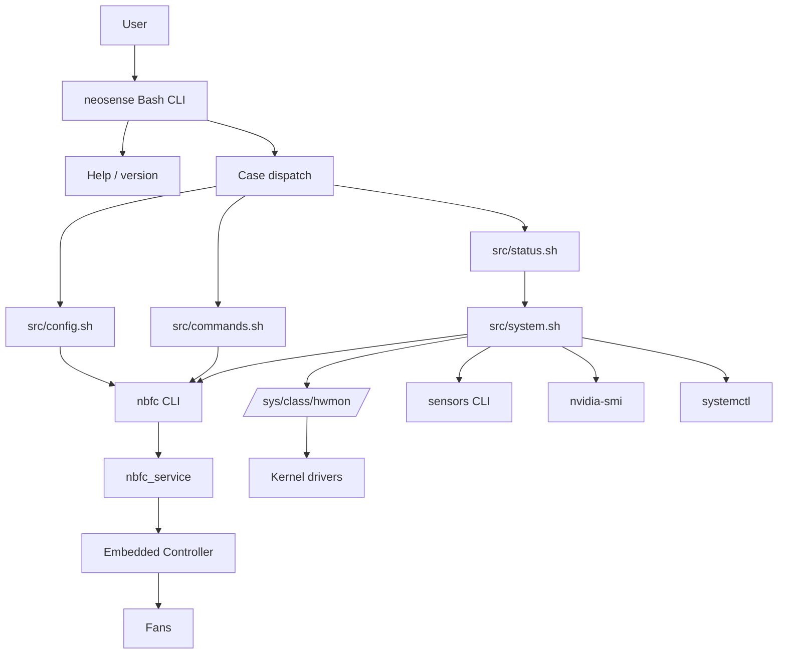
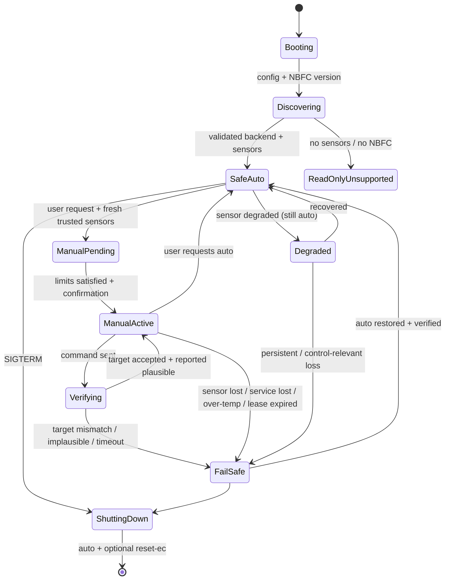
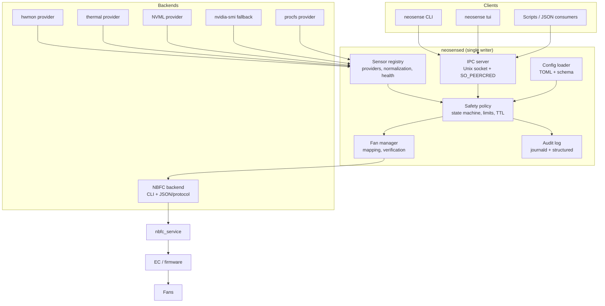
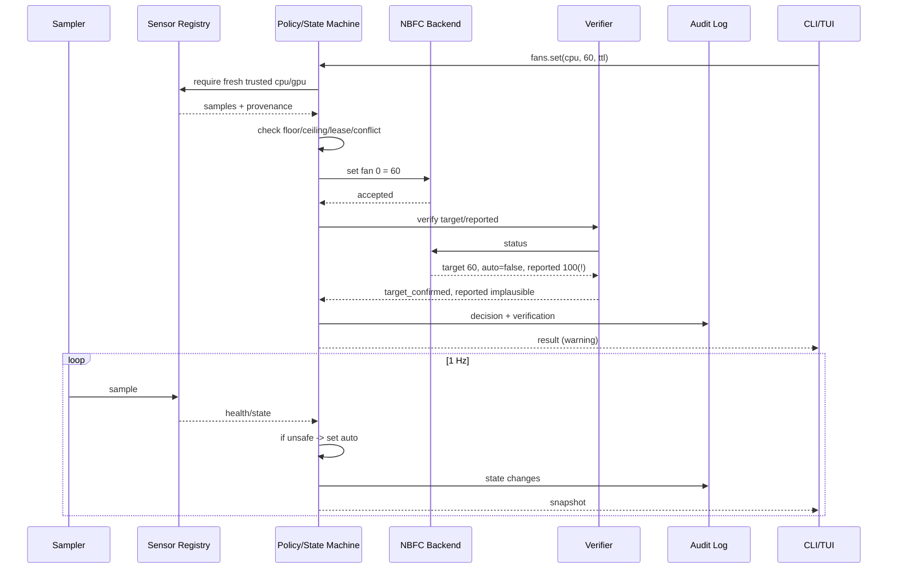

# NeoSense — Technical Audit and Architecture Proposal

**Audit date:** 2026-11-08  
**Audit classification:** Read-only audit and architecture design. No production implementation was changed.  
**Repository:** `https://github.com/NeonMC23/NeoSense`  
**Audited commit:** `ad2cd8b71e5d91542fe74ac22b27bdb7ddb5cc23` (`main`)  
**Audited tag:** `CLI-Release-NeoSense-v1.0.1` (points at the same commit)  
**License:** MIT  
**Audit environment:** Nobara Linux 44, kernel `7.3.0-203.nobara.fc44.x86_64`, Acer Nitro AN515-57 (i5-11400H, RTX 3050 Mobile), NBFC 0.5.3, NVIDIA proprietary driver.

> **Evidence labels used throughout**
>
> - **[VERIFIED]** — reproduced by executing a read-only command, inspecting the local system, or reading the relevant upstream source code.
> - **[LIKELY]** — strongly supported by code inspection but not exercised on the exact hardware/version.
> - **[NEEDS HARDWARE VALIDATION]** — cannot be decided from this machine; requires a specific laptop/EC/GPU combination.
> - **[RECOMMENDATION]** — an architecture or product decision proposed by this audit.
> - **[OPEN]** — unresolved question, dependency risk or design choice.

**Contents:** [1. Executive summary](#1-executive-summary) · [2. Repository state](#2-actual-repository-state) · [3. Existing architecture](#3-existing-architecture) · [4. Strengths](#4-current-implementation-strengths) · [5. Bugs and weaknesses](#5-bugs-and-technical-weaknesses) · [6. Sensor system](#6-sensor-system-assessment) · [7. Thermal safety](#7-thermal-safety-assessment) · [8. CLI](#8-cli-improvement-proposal) · [9. TUI](#9-tui-proposal) · [10. Language comparison](#10-language-and-architecture-comparison) · [11. Target architecture](#11-recommended-target-architecture) · [12. Dependencies](#12-dependencies-and-external-foundations) · [13. Testing](#13-testing-and-validation-strategy) · [14. Compatibility](#14-compatibility-considerations) · [15. Roadmap](#15-prioritized-improvement-roadmap) · [Appendices](#appendix-a--key-code-references)

---

## 1. Executive summary

NeoSense is a small, readable Bash wrapper around NBFC (Notebook FanControl). It is **949 lines of shell and installation code** plus a 375-line README. It is an early prototype with a clean command vocabulary and a sensible high-level idea, but it is **not yet a reliable thermal-management utility**.

The audit found that the two most important user-facing features are broken on the current NBFC version:

1. **[VERIFIED] The `status` dashboard never parses fan data.** `src/status.sh` uses case-sensitive AWK patterns such as `Fan display name` and `Auto control enabled`, while NBFC prints `Fan Display Name` and `Auto Control Enabled`. As a result, fan speeds and fan modes are never read. The uninitialised `fan_count` variable then causes `[: : integer expected`, and the dashboard silently displays `Current 0% / Target 0%` — a dangerous false reading that looks like a stopped fan.
2. **[VERIFIED] `neosense manual` is non-functional.** It calls `nbfc set -f 0` and `nbfc set -f 1` without `-s` or `-a`. NBFC requires one of those options and exits with usage code 2. The command therefore always fails.

Several other problems are equally serious:

- **[VERIFIED] The GPU fallback can report a non-GPU sensor as the GPU.** On the audit machine, the `sensors` fallback selects the first line matching `edge|junction|mem|gpu|temp1`, which is the **Intel Wi-Fi chip** (`iwlwifi_1`, `temp1`), not the NVIDIA GPU. If `nvidia-smi` is unavailable or returns a non-integer, NeoSense will silently label Wi-Fi temperature as GPU temperature. The same pattern can select NVMe, ACPI or motherboard sensors.
- **[VERIFIED] The tool allows fan speeds as low as 0–25% unconditionally, with no temperature or sensor gate.** `set both 0` is accepted, `silent` is a fixed 25%, and no command verifies that sensors are valid or that the fan actually changed. This directly contradicts the safety posture a thermal utility needs.
- **[VERIFIED] `config use` is broken on NBFC 0.5.4 and unsafe on all versions.** NBFC 0.5.4 removed `nbfc config -a|--apply`; NeoSense still calls it and suppresses the error. Even on 0.5.3, NeoSense applies an arbitrary model configuration and immediately restarts the service in write mode, without `nbfc rate-config` or a read-only trial. Upstream NBFC explicitly warns that a wrong configuration can write battery/control registers and cause hardware damage.
- **[VERIFIED] The root requirement is security theatre.** NBFC's control socket is mode `0666`; NBFC documentation states "Fan Control Rights: Any user", and the audit confirmed an unprivileged `nbfc set` reaches the service. Running the whole Bash CLI as root does not create a security boundary, while any local user can bypass NeoSense and drive fans directly.
- **[VERIFIED] Fan read-back is not trustworthy on the audit machine.** NBFC's log shows raw EC values (`3061`, `3488`, `4615`, `5084`) outside the configured `MinSpeedValueRead/MaxSpeedValueRead` range (`0..100`). NBFC clamps them, and `nbfc status` consequently reports `Current Fan Speed: 100.00` while the target is 35–40%. NeoSense displays that as "Current 100%" with no caveat. A requested speed, an NBFC target, a clamped EC read-back and a real tachometer RPM are four different quantities.
- **[VERIFIED] Both fans on the audit configuration use the CPU sensor group.** `nbfc sensors show` reports `Sensors: @CPU` for both CPU and GPU fans. NBFC therefore controls the GPU fan from CPU temperature, not GPU temperature. Nothing in NeoSense detects or surfaces this, even though it changes what "GPU fan control" means.

**Main recommendation:** do **not** start with a full rewrite. The existing Bash implementation can be improved substantially without a rewrite for its current scope: the parser, manual mode, config handling, install permissions and tests are all fixable in place. Keep Bash for installation, packaging and system integration, and fix the existing implementation first (Phase 0). A compiled core is justified by the **supervisor, typed sensor abstraction and TUI** requirements, not by language preference. Introduce that core after Phase 0, with a **dedicated safety supervisor** owning manual fan control. Rust is the recommended core language because the problem is dominated by typed state machines, provenance and exhaustive failure handling; Go is a credible alternative if maintainer velocity matters more than type-level safety. Python is not recommended for the privileged/control core.

**Target architecture in one sentence:** a read-only-capable CLI and TUI communicate over a local socket with a long-running `neosensed` supervisor that normalises sensors with provenance and trust, enforces thermal safety policy, drives NBFC through a version-aware backend, verifies every control action, and returns to a safe auto/firmware state on any failure.

---

## 2. Actual repository state

### 2.1 Git state at audit start

```
Remote        : https://github.com/NeonMC23/NeoSense
Branch        : main
HEAD          : ad2cd8b71e5d91542fe74ac22b27bdb7ddb5cc23
Working tree  : clean
Tags          : CLI-Releas-French (152b779), CLI-Release-NeoSense-v1.0.1 (ad2cd8b)
GitHub release: v1.0.1, published 2026-10-18
```

The working tree was empty before cloning; the repository was cloned from the official URL. No pre-existing user checkout existed.

### 2.2 Files and size

| File | Lines | Purpose | Notes |
|---|---:|---|---|
| `neosense` | 182 | CLI entry point, help, dispatch | Mode `100644` (not executable in Git) |
| `src/utils.sh` | 91 | colours, logging, root check, validation | `NO_COLOR` support |
| `src/system.sh` | 139 | CPU/GPU temperatures, systemd operations | Most sensor risk lives here |
| `src/config.sh` | 104 | NBFC config list/current/apply | Broken fallback; unsafe apply |
| `src/status.sh` | 186 | dashboard parsing and rendering | Case-sensitive parser; primary bug |
| `src/commands.sh` | 125 | auto/manual/set/presets | `manual` invalid; fixed presets |
| `install.sh` | 73 | copy to `/usr/local/share/neosense`, symlink | Not executable; relative paths |
| `uninstall.sh` | 49 | remove symlink and directory | Not executable; does not reset fans |
| `README.md` | 375 | user documentation | Several claims do not match behaviour |
| `LICENSE` | — | MIT | 2026 NeoSense contributors |

**Total shell code: 949 lines.** There are no project-level hidden files or automation (no `.github/`, `.gitignore`, CI, tests, man pages, completions, packaging, `CONTRIBUTING`, `SECURITY` or `CHANGELOG`).

### 2.3 Version and release inconsistency

- `neosense` prints `NeoSense version 1.0` and `NeoSense v1.0`.
- `src/status.sh` prints `NeoSense v1.0`.
- README badge and text describe `v1.0`.
- The latest release is `v1.0.1`.
- The Git tag is named `CLI-Release-NeoSense-v1.0.1`; the older tag is `CLI-Releas-French` (typo).

There is no single source of truth for the version. This is a release-engineering problem, not cosmetic: users cannot tell which build they are running, and bug reports will be ambiguous.

### 2.4 README vs implementation

| README claim | Actual state | Evidence |
|---|---|---|
| `neosense status` displays current and target fan speeds | Fan parsing never matches; shows `0%`; arithmetic error on stderr | `src/status.sh:48-88`; audit run |
| `neosense manual` keeps current speeds | Calls invalid `nbfc set -f N`; always fails | `src/commands.sh:18-39`; NBFC usage exit 2 |
| Presets set 25/60/80/100% | True, but they are unconditional fixed speeds with no thermal gate | `src/commands.sh:107-125` |
| `neosense config use` applies a profile and restarts | Uses `nbfc config -a`, removed in NBFC 0.5.4; no safety validation | `src/config.sh:91`; NBFC 0.5.4 changelog |
| Installation is `sudo ./install.sh` | File is mode `100644`; the documented command fails with "Permission denied" | `git ls-files -s`; `./install.sh` |
| Requirements are "Bash and standard system utilities" | Also needs systemd, GNU `find -printf`, `readlink -f`, `nvidia-smi` or `sensors`, and a compatible NBFC version | `src/*.sh`, `install.sh` |
| GPU N/A troubleshooting is sufficient | The fallback can silently show Wi-Fi/NVMe/ACPI temperature as GPU | `src/system.sh:72-79` |

### 2.5 Audit environment relevance

The audit machine is an Acer Nitro AN515-57, which is also the model of the locally selected NBFC configuration. This provides concrete verification, but it is not evidence that the project targets only this model. The machine has:

- Intel i5-11400H with `coretemp` (`Package id 0` + six cores) and `x86_pkg_temp` thermal zone.
- NVIDIA RTX 3050 Mobile, exposed through `nvidia-smi`; no `amdgpu` hwmon.
- Two NBFC fans, both mapped to `@CPU` sensors.
- 318 NBFC configuration files in `/usr/share/nbfc/configs` (installed set).
- NBFC 0.5.3; the installed build predates upstream 0.5.4 (released 2026-10-10).

This is useful, but **one laptop is not a compatibility matrix**. The audit explicitly separates verified behaviour on this machine from claims that need broader hardware validation.

### 2.6 Generated audit artifacts

Only documentation was generated:

- `docs/audit/NEOSENSE_TECHNICAL_AUDIT.md` — this report.
- `docs/audit/EVIDENCE_LOG.md` — captured read-only commands and outputs.
- `docs/audit/README.md` — audit index and Git-state statement.

No production source, manifest, lockfile, systemd unit, configuration or installed system file was modified. No commits or pushes were made.

---

## 3. Existing architecture

### 3.1 Current structure



### 3.2 Control flow

1. `neosense` resolves its own directory with `readlink -f`, checks that the five `src/*.sh` files exist, and sources them in a fixed order (`utils`, `system`, `config`, `status`, `commands`).
2. Before dispatching any command except `--help`, `--version` or empty, it calls `check_nbfc_installed`. This means even `status` cannot read hwmon temperatures if the `nbfc` binary is missing.
3. A flat `case "$1"` dispatches to functions. Nested `case` blocks handle `set`, `daemon` and `config`.
4. Control functions call `require_root`, then `nbfc set ...` and report success based solely on the NBFC exit code.
5. `status` combines `systemctl`, `nbfc status -a`, `get_cpu_temp`, `get_gpu_temp`, and fixed formatting.

### 3.3 Layer responsibilities as implemented

| Layer | Responsibility | Coupling |
|---|---|---|
| `neosense` | argument parsing, help, dispatch, NBFC presence check | Knows every module and command name |
| `utils.sh` | TTY colours, logging, root check, integer/speed validation, NBFC check | Sourced globally; defines colours used by all |
| `system.sh` | sensor discovery and systemd lifecycle | Knows NBFC service name and hwmon layout |
| `config.sh` | NBFC config discovery/apply | Parses human output and `/etc/nbfc/nbfc.json` |
| `status.sh` | status and presentation | Duplicates systemd logic; parses NBFC human output |
| `commands.sh` | fan control and presets | Hard-codes fan indices 0/1 |
| `install.sh` / `uninstall.sh` | filesystem installation | Independent copies of logging/colour helpers |

### 3.4 Architectural weaknesses

- **No separation between reading and controlling.** The same script process both samples sensors and writes fan speeds. There is no supervisor, no state machine, no continuous monitoring and no fail-safe after the command exits.
- **Human-output parsing is the integration contract.** NBFC's CLI output is parsed with `grep`, `awk`, `cut`, `xargs` and `tr`. NBFC 0.5.4 added `nbfc status --json`; NeoSense does not use it. The parser is case-sensitive, locale-fragile and version-fragile.
- **No normalised sensor model.** Temperatures are bare strings or integers with no unit, provider, path, timestamp, validity or trust. `N/A`, empty string and `0` are conflated in different places.
- **No capability model.** The code assumes two fans, fan 0 = CPU and fan 1 = GPU, and that every laptop exposes `coretemp`/`k10temp` and `nvidia-smi`/`amdgpu`.
- **No verification.** `nbfc set` exit 0 means the service accepted a request, not that the EC changed speed. There is no read-back, settling window, target check or RPM check.
- **No persistent safety policy.** Presets are fixed percentages; there is no curve, no temperature ceiling, no lease/TTL, no automatic return to auto, and no detection of conflicting controllers.
- **Duplicated logic.** Systemd active/enabled checks exist in both `system.sh` and `status.sh`; logging/colour helpers are duplicated in `install.sh` and `uninstall.sh`.
- **Hard-coded paths and service names.** `/usr/share/nbfc/configs`, `/etc/nbfc/nbfc.json`, `nbfc_service`, `/usr/local/...` are embedded rather than discovered.
- **No tests.** There is no fixture, mock, integration test or CI. ShellCheck was not part of the project.

### 3.5 Why this matters

The current design can be adequate for a hobby wrapper that prints a temperature and calls NBFC. It is not adequate for a tool that claims to manage thermal safety:

- A failed sensor can become `0%` or a Wi-Fi temperature.
- A successful command can leave the fan unchanged.
- A manual setting can persist across reboot.
- A wrong model configuration can be applied with one command.
- The UI cannot distinguish "auto", "manual", "critical override" or "unknown".
- Nothing survives the CLI process exit.

These are architectural, not cosmetic, gaps.

---

## 4. Current implementation strengths

The existing implementation is worth preserving as a starting point. It is not a throwaway.

1. **Clear high-level product idea.** The command vocabulary (`status`, `auto`, `manual`, `set`, presets, `daemon`, `config`) is understandable and maps to real NBFC operations. It is a better UX than memorising `nbfc set -f 0 -s 60`.
2. **Good modular split for a small project.** Responsibilities are separated into utilities, system, config, status and commands. The structure is easy to read and to extend.
3. **Safe delegation to NBFC.** NeoSense does not poke EC registers directly. That is the correct boundary: NBFC owns the model configuration, EC access and critical-temperature handling. A wrapper should not reimplement that.
4. **Sensible input validation.** Fan speeds are validated as integers in `0..100` before invoking NBFC; config names and speed values are quoted; no `eval`, no `sh -c`, and no command-injection path was found. ShellCheck 0.10.0 found no error-level diagnostics, only unused-variable and `ls` notes.
5. **Colour and accessibility baseline.** `NO_COLOR` is honoured when stdout is not a TTY; output is plain when piped. This is a good foundation for machine-readable output, even though JSON is not implemented.
6. **Symlink-aware entry point.** `readlink -f "$0"` makes the installed `/usr/local/bin/neosense` symlink work.
7. **Root checks at operation boundaries.** `require_root` is used for fan control, config changes and service changes. Even though the security model is wrong (see below), the intent is correct.
8. **Installation is simple.** A copy plus symlink is easy to audit and easy to package. It does not require a compiler or runtime.
9. **Documentation is readable and honest about being a wrapper.** The README says NeoSense is not a replacement for NBFC and that hardware support varies. It also labels presets as illustrative. That is better than claiming universal support.
10. **No dangerous experiments in the repository.** There is no code that disables thermal protection, writes arbitrary EC registers or runs `sensors-detect` automatically.

The correct strategy is to **retain the domain knowledge and command vocabulary**, not necessarily the implementation language or the parsing approach.

---

## 5. Bugs and technical weaknesses

### 5.1 Severity summary

| ID | Severity | Finding | Evidence |
|---|---|---|---|
| B1 | Critical | Status parser never matches NBFC's Title-Case keys; fan speeds/mode lost; arithmetic error | `src/status.sh:48-88`; audit run |
| B2 | Critical | `manual` calls `nbfc set -f N` without `-s`/`-a`; always fails | `src/commands.sh:18-39`; `nbfc set -f 999` exit 2 |
| B3 | Critical | Mode detection compares `"False"` to NBFC's lowercase `false`; manual never shown | `src/status.sh:94-98` |
| B4 | Critical | GPU sensor fallback can return Wi-Fi/NVMe/ACPI temperature as GPU | `src/system.sh:72-79`; audit selected `iwlwifi_1/temp1` |
| B5 | Critical | Fixed presets (especially `silent` 25%) have no temperature or sensor gate; `0%` allowed | `src/commands.sh:42-125` |
| B6 | Critical | `config use` calls removed `nbfc config -a`; no rate-config/read-only validation | `src/config.sh:78-103`; NBFC 0.5.4 changelog |
| B7 | High | Fan index 0/1 hard-coded as CPU/GPU; names parsed but unused; partial `set both` reports success | `src/status.sh:32-40,130-141`; `src/commands.sh:88-103` |
| B8 | High | No verification of requested/target/reported speed; EC read-back clamped to 100% on audit machine | `src/commands.sh:51`; NBFC journal |
| B9 | High | Root requirement is not a security boundary; NBFC socket is `0666` and fan control is allowed to any user | `src/utils.sh:61-66`; `ls -l /run/nbfc_service.socket` |
| B10 | High | Invalid/unreadable sensor values can crash arithmetic or be silently mislabelled; negative sign is stripped | `src/system.sh:14-20,30,49-54,74` |
| B11 | High | `get_current_config` fallback uses `SelectedConfigName`, but current NBFC uses `SelectedConfigId`; always `None` when service stopped; also strips spaces | `src/config.sh:15-23`; `/etc/nbfc/nbfc.json` |
| B12 | High | Documented install/uninstall commands fail: scripts are mode `100644` | `git ls-files -s`; `./install.sh` |
| B13 | High | `daemon status` output is malformed/misleading; `is-enabled` semantics not handled | `src/system.sh:121-139`; audit output |
| B14 | High | No tests, CI, linting, shellcheck or fixtures | repository inventory |
| B15 | Medium | Version is hard-coded in three places and disagrees with release `v1.0.1` | `neosense:28,65`; `status.sh:163` |
| B16 | Medium | No JSON output, no stable exit codes, no logging/audit trail | `neosense` dispatch |
| B17 | Medium | No locking; concurrent set/config/service calls can race | code inspection |
| B18 | Medium | Hard-coded paths/service names; non-systemd distros misreported as "Stopped/Disabled" | `src/system.sh`, `src/config.sh` |
| B19 | Medium | Multi-GPU/hybrid GPU selection is arbitrary; multi-GPU `nvidia-smi` output fails integer validation | `src/system.sh:62-69` |
| B20 | Medium | `status` spawns ~46 processes; 0.05 s warm, 1.59 s cold; unsuitable for live UI | `strace`/timing |
| B21 | Low | Extra arguments ignored (`status extra`, `set cpu 50 extra`) | dispatch |
| B22 | Low | Unknown command requires NBFC first; misleading if NBFC missing | `neosense:69` |
| B23 | Low | `echo -e` on user/config strings allows terminal escape injection (not command injection) | `utils.sh:39-53` |
| B24 | Low | Leading-zero speeds (`010`) validated as octal 8 but passed as decimal string to NBFC | `utils.sh:69-80` |
| B25 | Low | `uninstall.sh` can delete an unrelated `/usr/local/bin/neosense`; does not reset fan state | `uninstall.sh:37-46` |

### 5.2 B1 — status parser is case-sensitive and leaves `fan_count` uninitialised

`src/status.sh` builds a synthetic key/value stream:

```bash
/Fan display name/ { ... print "FAN_" fan_count "_NAME:" $2 }
/Auto control enabled/ { ... }
/Current fan speed/ { ... }
/Target fan speed/ { ... }
/Selected config name/ { ... }
END { print "FAN_COUNT:" fan_count }
```

Actual NBFC 0.5.3 output (verified):

```
Selected Config Name     : Acer Nitro AN515-57 Custom
Fan Display Name         : CPU fan
Temperature              : 49.88
Auto Control Enabled     : true
Critical Mode Enabled    : false
Current Fan Speed        : 100.00
Target Fan Speed         : 35.00
Fan Speed Steps          : 100
```

Only `/Temperature/` matches. Because `fan_count++` never executes, AWK leaves `fan_count` uninitialised. In AWK, string concatenation of an uninitialised variable yields the empty string, so the final line is `FAN_COUNT:` with no value. The shell then executes:

```bash
if [ "$fan_count" -ge 2 ]; then
```

with an empty value, producing:

```
/home/.../src/status.sh: line 134: [: : integer expected
```

The dashboard still exits 0 and prints:

```
CPU
  Temp      58°C
  Current   0%
  Target    0%
GPU
  Temp      52°C
  Current   N/A
  Target    N/A
```

**Impact:** the primary feature is wrong. Worse, `0%` is a plausible-looking value; a user may believe the fan is stopped, while `N/A` is shown for the other fan. This is exactly the "failed sensor silently becomes a normal reading" failure mode the project must eliminate.

**Fix direction:** use `nbfc status --json` when available (NBFC ≥ 0.5.4); for older versions, parse exact NBFC keys with a validated state machine, default to `unknown` (never 0), and fail the command if the parse does not contain the expected fields. Add fixture tests for both formats.

### 5.3 B2 — `manual` uses an invalid NBFC invocation

`src/commands.sh`:

```bash
if nbfc set -f 0 >/dev/null 2>&1; then ...
if nbfc set -f 1 >/dev/null 2>&1; then ...
```

NBFC's `set` command requires exactly one of `-a` or `-s PERCENT`:

```
Usage: nbfc set [-h] (-a | -s PERCENT) [-f FAN INDEX]
```

Running `nbfc set -f 999` (safe invalid fan test) exits 2 with this usage. Therefore both calls fail, `success` stays 0, and `manual` prints "Failed to switch fans to manual mode."

There is no NBFC operation that means "switch to manual while keeping the current speed" without specifying a speed. To implement it, NeoSense must read the current requested/target speed first, then set that value explicitly, or drop the command in favour of explicit `fan set`. Using the read-back `CurrentSpeed` is not safe on hardware where the EC read-back is implausible (see B8).

**Fix direction:** remove or redesign `manual`. A supervisor should own a "hold current target" operation, validate the value, and verify it. Do not silently substitute 0.

### 5.4 B3 — mode detection never sees manual mode

NBFC prints `Auto Control Enabled : false` (lowercase). `src/status.sh` checks:

```bash
if [ "$fan_1_auto" = "False" ] || [ "$fan_2_auto" = "False" ]; then
```

`false` is not `False`. Even if B1 were fixed, manual mode would still be reported as `Auto`. The same applies to `Critical Mode Enabled`, which is parsed nowhere.

**Fix direction:** parse booleans case-insensitively into a real boolean, or use JSON `AutoMode`/`Critical` fields. Never compare display strings directly.

### 5.5 B4 — GPU fallback can report a non-GPU sensor

`src/system.sh` GPU fallback:

```bash
temp=$(sensors 2>/dev/null \
  | grep -E '(edge|junction|mem|gpu|temp1)' \
  | head -n 1 \
  | grep -oE '[+-][0-9.]+' | head -n 1 \
  | cut -d'.' -f1 | tr -d '+-')
```

On the audit machine, `sensors` output order is `coretemp`, NVMe, battery, `iwlwifi_1`, UCSI, second NVMe, `acpitz`. The first line matching `temp1` is:

```
iwlwifi_1-virtual-0
temp1:        +54.0°C
```

If `nvidia-smi` is missing or returns more than one line, this function returns the **Wi-Fi chip temperature** as GPU temperature. `temp1` also appears on `acpitz` and many motherboard chips. The `mem` pattern can match memory temperatures, and `gpu` can match unrelated labels.

**Impact:** a user can see a cool "GPU" while the discrete GPU is hot; fan policy based on that value would be unsafe. This is a textbook silent mislabelling bug.

**Fix direction:** never infer a role from a generic keyword across the entire `sensors` output. Use typed providers (NVML/amdgpu hwmon) with chip identity and labels. If `sensors` is used at all, parse `sensors -j` and match by chip name plus role-specific labels, and mark it low trust.

### 5.6 B5 — fixed presets are open-loop and unsafe

Presets are:

| Preset | CPU | GPU | Problem |
|---|---:|---:|---|
| turbo | 100% | 100% | Safe thermally, loud |
| performance | 80% | 80% | Usually safe, no feedback |
| balanced | 60% | 60% | Usually safe, no feedback |
| silent | 25% | 25% | **Can be unsafe under sustained load** |

`set both 0` is also accepted. There is:

- no check that the NBFC service is running,
- no check that a valid CPU/GPU temperature exists,
- no minimum duty based on temperature,
- no confirmation,
- no lease or automatic expiry,
- no read-back verification,
- no detection of a conflicting controller.

On the audit machine, both fans are driven by `@CPU` sensors, so "GPU 25%" does not respond to GPU temperature at all. A user running a GPU workload with the "silent" preset can heat the GPU while the GPU fan stays at 25%.

**Fix direction:** presets must become closed-loop policies (curves) or be renamed to "fixed fan presets" with explicit warnings. Manual control must be gated by fresh, trusted sensors and a temperature-dependent floor. `0%` should require an explicit, guarded operation and should be forbidden when temperatures are above a safe threshold.

### 5.7 B6 — config application is broken on NBFC 0.5.4 and unsafe everywhere

`src/config.sh`:

```bash
if nbfc config -a "$config_name" >/dev/null 2>&1; then
    ...
    systemctl restart nbfc_service
```

NBFC 0.5.4 changelog:

> Removed `nbfc config -a|--apply` option. A notice will be printed saying that `nbfc config -s|--set` should be used instead.

Upstream code confirms `Config_Apply()` prints a notice and returns `NBFC_EXIT_FAILURE` (verified in upstream source/changelog; this audit ran the installed 0.5.3 binary, not a 0.5.4 binary). NeoSense suppresses the output, so the user sees only "Failed to apply config. Please check if name is valid." — a misleading diagnosis.

Even on 0.5.3, the operation is dangerous. NBFC's own `--recommend` warning states:

> The recommendation mechanism is based solely on loose string matching of laptop model names. A similar model name does not imply that the configuration can be used safely. In the worst case, a misapplied configuration may write to battery control registers, potentially causing permanent battery damage or hardware failure.

NBFC 0.5.4 recommends:

```
sudo nbfc config --set "CONFIG"
sudo nbfc restart --read-only
# verify
sudo nbfc restart
```

and provides `nbfc rate-config` to assess a configuration. NeoSense does neither the read-only trial nor the rating.

**Fix direction:** do not expose a one-shot "apply and restart in write mode". Require an explicit validated config filename, run `nbfc rate-config -j`, show the result, require confirmation, apply with `--set`, restart in read-only mode, verify sensors/fans, and only then allow write mode. Never auto-select by model-name similarity.

### 5.8 B7 — fan mapping and partial success

- `src/status.sh` initialises `fan_1_name="CPU"`, `fan_2_name="GPU"`, parses `Fan Display Name`, then **never uses the names** (ShellCheck SC2034).
- `src/commands.sh` assumes fan 0 = CPU and fan 1 = GPU for all laptops.
- `set both` succeeds if one of two calls succeeds and prints "CPU fan speed set (GPU fan not available or failed)" while returning **success**.
- Fans beyond index 1 are ignored.
- If a config names fans differently or orders them GPU-first, commands act on the wrong fan.

**Impact:** on a one-fan laptop, `set gpu` fails; on a three-fan laptop, the third fan is unreachable; on a reversed config, `set cpu` changes the GPU fan. The UI claims a mapping it never verified.

**Fix direction:** enumerate fans from `nbfc status --json` (`Name`, index), build a role mapping (CPU/GPU/other) with explicit user override, and address fans by stable ID. A partial operation must return a distinct error/exit code, not success.

### 5.9 B8 — no verification; read-back can be meaningless

`nbfc set` returns success when the service accepts a JSON request. It does not prove that the EC accepted the value, that the fan changed, or that the requested speed is reachable.

On the audit machine, NBFC logs every second:

```
CPU fan: Fan speed value (3488) not range of MinSpeedValueRead/MaxSpeedValueRead
GPU fan: Fan speed value (5084) not range of MinSpeedValueRead/MaxSpeedValueRead
```

The config declares `MinSpeedValueRead=0`, `MaxSpeedValueRead=0` and `IndependentReadMinMaxValues=false`, so NBFC derives the read range from the write range (`0..100`). The EC returns raw values in the thousands. NBFC clamps to 100 and `Fan_FanSpeedToPercentage` yields 100%. `nbfc status` shows `Current Fan Speed: 100.00` while `Target Fan Speed` is 35/40%.

NeoSense displays "Current 100%" with no provenance or warning. A user could conclude the fan is at maximum while the EC is actually reporting a raw tach value that the config cannot interpret.

**Fix direction:** model four quantities separately:

- `requested_percent` — what NeoSense asked for;
- `target_percent` — NBFC's computed target (including critical override);
- `reported_percent` — EC read-back mapped by NBFC (may be implausible);
- `rpm` — tachometer from hwmon, when available.

Only `rpm` is direct physical evidence. `target` confirms acceptance; `reported` must be range/sanity checked and labelled. Verification must be a first-class state: `accepted`, `confirmed_percent`, `confirmed_rpm`, `implausible`, `unavailable`.

### 5.10 B9 — root requirement and the NBFC socket

`require_root` runs the whole CLI as root for control. But:

- `/run/nbfc_service.socket` is `srw-rw-rw-` (mode `0666`, verified).
- NBFC upstream README states "Fan Control Rights: Any user".
- The audit confirmed an unprivileged `nbfc set` reaches the service (it rejected only the invalid fan index).
- Any local user can therefore set any fan speed directly, bypassing NeoSense.

So `sudo neosense` does not make NeoSense safer; it only makes the shell process more privileged, increasing the impact of a shell bug or a manipulated environment. It also creates a poor UX ("run everything as root") and prevents unprivileged TUI clients.

**Fix direction:** treat fan control as a local-policy problem, not a root problem. Use a supervisor with a group-restricted socket; keep config/service operations behind polkit or explicit sudo; never require root for read-only status/sensors. Document the upstream `0666` limitation honestly; do not claim a security boundary that does not exist.

### 5.11 B10 — sensor parsing is unsafe

`get_cpu_temp` / `get_gpu_temp`:

```bash
temp_raw=$(cat "$temp_file")
echo $((temp_raw / 1000))
```

Problems:

- If `cat` fails (permission, device removal), `set -e` can abort the whole command; if it does not, arithmetic on an empty string is a syntax error.
- If the file contains a non-numeric value, `$((...))` errors.
- `0` is treated as a valid temperature; a disabled/failed channel can look like 0°C.
- No range check, no unit check, no label check, no timestamp.
- The `sensors` fallback does `tr -d '+-'`, which **strips the minus sign**: `-5°C` becomes `5°C`. That is a direct false-normal-reading bug.
- `cut -d'.' -f1` truncates rather than rounds; `-0.5` can become `0`.
- `nvidia-smi` output is checked with `is_integer`, which rejects multi-GPU newline-separated output; the code then falls through to the unsafe `sensors` path.
- No timeout: a hung `nvidia-smi`, `sensors`, `systemctl` or `nbfc` blocks the command indefinitely.

**Fix direction:** central typed parser with `Result`, finite/range checks, explicit unit conversion, per-provider error types, timeouts, and no string sentinel. Never strip signs. Never treat a failed read as 0.

### 5.12 B11 — config fallback key is wrong

`src/config.sh` fallback:

```bash
grep -i '"SelectedConfigName"' /etc/nbfc/nbfc.json \
  | cut -d':' -f2 | tr -d '", \t'
```

Current `/etc/nbfc/nbfc.json` is:

```json
{
  "SelectedConfigId": "Acer Nitro AN515-57 Custom"
}
```

The key is `SelectedConfigId`, not `SelectedConfigName`. The fallback therefore returns empty and `get_current_config` returns `"None"` whenever the NBFC service is stopped. Additionally, `tr -d '", \t'` removes spaces from config names, so even a matching key would produce `AcerNitroAN515-57Custom`.

**Fix direction:** prefer `nbfc status --json` `SelectedConfigId`; if parsing `/etc/nbfc/nbfc.json`, use a JSON parser, not `grep`, and preserve whitespace. Do not rely on an internal file format without a version check.

### 5.13 B12 — documented install commands fail

`git ls-files -s` shows mode `100644` for `install.sh`, `uninstall.sh` and `neosense`. The README says:

```bash
sudo ./install.sh
sudo ./uninstall.sh
```

Running `./install.sh` produced "Permission denied" (verified). `sudo` does not add the execute bit. The user must run `bash install.sh` or `chmod +x` first, neither of which is documented. The installer also uses relative paths (`cp neosense`, `cp src/*.sh`), so invoking `/path/to/install.sh` from another working directory fails.

**Fix direction:** commit the executable bit (`git update-index --chmod=+x`), resolve the script directory and use absolute paths, and support `bash install.sh` explicitly.

### 5.14 B13 — daemon status is malformed

`daemon_status` prints:

```
Running
Autostart :
Enabled
```

The active state has no `Service :` label; `Autostart :` is on its own line. `systemctl is-enabled` returns 0 for several unit-file states (`static`, `indirect`, `generated`, `alias`), so "Enabled" can be inaccurate; a masked unit is reported as "Disabled" without distinguishing "masked". If `systemctl` is absent, both checks fail and the output says "Stopped / Disabled" instead of "systemd unavailable".

**Fix direction:** use `systemctl show -p ActiveState,SubState,UnitFileState,LoadState` or `systemctl is-system-running`, and render explicit labels. Distinguish `active`, `reloading`, `activating`, `deactivating`, `failed`, `inactive`, `masked`, `static`.

### 5.15 B14 — no tests or CI

There is no test directory, no fixtures, no CI workflow, no linter configuration and no release checklist. The status parser bug would have been caught by one fixture test. The `manual` bug would have been caught by one fake-NBFC test.

**Fix direction:** treat tests as part of the safety case, not optional polish. See Section 13.

### 5.16 B15–B20 — medium issues

- **Version drift:** `1.0` in code vs `v1.0.1` release. Single-source the version and print commit/date in `--version`.
- **No JSON/exit codes:** automation cannot distinguish "service down" from "invalid argument" from "unsupported hardware". All paths mostly exit 1.
- **No locking:** two `neosense set` or `config use` processes can race; `nbfc config -a` + restart is not atomic. Add an advisory lock in the supervisor.
- **Hard-coded platform:** `nbfc_service`, systemd, `/usr/share/nbfc/configs`, `/etc/nbfc/nbfc.json`. NBFC supports OpenRC/SysV; NeoSense should discover or clearly declare a systemd requirement.
- **Multi-GPU:** `nvidia-smi` query without `--id` returns one line per GPU; `is_integer` rejects it. `amdgpu` is preferred even if it is an iGPU and a discrete NVIDIA GPU exists. Define a GPU selection policy and expose all GPUs.
- **Performance:** 46 `execve` calls per status (verified via `strace`), 0.05 s warm and 1.59 s cold. That is acceptable for a one-shot CLI, not for a 1 Hz TUI that shells out per frame.

### 5.17 B21–B25 — low issues

- Extra arguments are silently ignored; scripts that pass `status --json` get human output and exit 0.
- Unknown commands still require NBFC; the error is about NBFC rather than the unknown command.
- `echo -e` interprets backslashes in user-supplied strings (terminal escape injection); use `printf '%s'`.
- Leading-zero values are accepted by `is_integer`; `010` is treated as octal in arithmetic but passed as the string `010` to NBFC, so validation and execution can disagree.
- `uninstall.sh` deletes `/usr/local/bin/neosense` if it is any regular file, not only the expected symlink; it also leaves NBFC in its last manual state. Verify the symlink target and offer to reset fans to auto.

### 5.18 What is *not* a bug

To avoid overstating the findings:

- No command-injection vulnerability was found. User input is quoted, speeds are numeric, and config names are passed as single arguments.
- The scripts pass `bash -n` and ShellCheck at warning level with no errors. The defects are semantic (parsing, state, safety), not syntax.
- `config list` exiting 141 under `| head` is normal SIGPIPE, not an application bug.
- The README's statement that NeoSense is a wrapper, not a replacement, is accurate and should be preserved.

---

## 6. Sensor-system assessment

### 6.1 What the current implementation does

| Function | Mechanism | What it actually returns |
|---|---|---|
| `get_cpu_temp` | Scan `/sys/class/hwmon/hwmon*`, accept chip `coretemp`, `k10temp`, `zenpower`; read first `temp*_input`; fallback to `sensors` grep | Integer °C, truncated; first channel, no label |
| `get_gpu_temp` | Scan hwmon for `amdgpu`, `nouveau`, `radeon`; then `nvidia-smi`; then `sensors` grep | Integer °C or empty; arbitrary GPU; unsafe fallback |
| `status.sh` | Calls the two functions; if CPU empty, substitutes NBFC's per-fan `Temperature` | Per-fan filtered EC value labelled as "CPU" |
| `nbfc status` | Shows per-fan `Temperature`, `Critical Mode Enabled`, `Current/Target Fan Speed` | NBFC's own filtered sensor and EC-mapped speeds |

There is no abstraction: no provider registry, no role assignment, no units, no validity, no freshness, no trust, no provenance, no conflict handling.

### 6.2 Linux interfaces

#### hwmon (`/sys/class/hwmon/`)

The kernel hwmon ABI is the primary source for temperatures, fan tachometers, PWM and power. Key facts:

- `hwmon*/name` identifies the driver/chip (`coretemp`, `k10temp`, `amdgpu`, `nvme`, `acpitz`, `iwlwifi_1`, ...).
- `tempN_input` is **millidegree Celsius** (some external-thermistor chips expose millivolts instead; the driver/ABI must be checked). `tempN_label` is optional. `tempN_crit`, `tempN_max`, `tempN_min`, `tempN_fault`/`tempN_alarm` provide limits and health.
- `fanN_input` is the tachometer value (RPM where the driver/EC exposes it); `fanN_label`, `fanN_min`, `fanN_max`, `fanN_fault` may be present.
- `pwmN` is 0–255, `pwmN_enable` selects control mode, and `pwmN_auto_point*` describes a hardware curve. Writing PWM requires privilege and must not be mixed with NBFC.
- `powerN_input` is **microwatts**; `energyN_input` is **microjoules**.
- Attributes are world-readable by ABI; writable attributes are privileged. Individual drivers may be read-only or fail with `EACCES`, `ENODATA`, `EIO`.
- `hwmonN` numbering is **not stable across boots**. Identify a device by `name` + the `device` symlink realpath + channel label, not by `hwmonN`.
- The kernel documentation explicitly warns that there is **no standard mapping** from the second temperature sensor to the CPU, or the second fan to the CPU. Role assignment must be explicit, not index-based.
- Not every channel is a temperature: `temp1` may be a battery, Wi-Fi, NVMe, ACPI zone or motherboard sensor. `acpitz` and vendor ACPI zones are often coarse or duplicated.

#### thermal (`/sys/class/thermal/`)

- `thermal_zone*/type` (e.g., `x86_pkg_temp`, `acpitz`, `TCPU`, `SEN2`) and `temp` (millidegree Celsius).
- `trip_point_*_temp/type`, `policy`, `mode`, and `cooling_device*` describe kernel thermal management.
- Useful as a fallback for CPU package (`x86_pkg_temp`) and as cross-check data. ACPI zones are lower trust: they may represent chassis or board locations, not the CPU/GPU die.
- Thermal zones can be duplicated by hwmon (`acpitz` appears in both). Deduplicate by device identity, not by value.

#### lm-sensors / `sensors`

- `sensors` applies `/etc/sensors.conf` labels, scaling and hiding; `sensors -j` emits JSON (modern lm-sensors).
- It is useful for diagnostics and human-readable inventory, but it is a **text/JSON presentation layer**, not the source of truth.
- Parsing default `sensors` text is locale/format fragile, and generic keywords are unsafe (see B4).
- libsensors is GPL-2.0; linking it into an MIT project would create licensing obligations. Shelling out to `sensors` is acceptable for diagnostics; sysfs should be read directly for the core.
- `sensors-detect` probes I/O ports and can be risky; NeoSense must never run it automatically or as part of `diagnose`.

#### CPU-specific interfaces

- **Intel:** `coretemp` exposes `Package id 0` plus `Core N`; `x86_pkg_temp` thermal zone is a package fallback. Multi-socket systems have multiple packages.
- **AMD:** `k10temp` exposes `Tctl` and, on many chips, `Tdie`/`Tccd*`. `Tctl` may include a control offset on some generations; prefer `Tdie` when present and disclose the choice. `zenpower` is an out-of-tree alternative.
- **ARM/other:** `soc_thermal`, vendor drivers; support must be evidence-based, not assumed.
- **Frequency/power:** `/sys/devices/system/cpu/.../cpufreq`, RAPL `/sys/class/powercap/intel-rapl:*` (energy in microjoules; permissions vary). RAPL is package/platform power, not per-core.

#### GPU-specific interfaces

- **AMD `amdgpu`:** hwmon channels typically `edge`, `junction`, `mem`; `gpu_busy_percent` under `/sys/class/drm/card*/device/`; power via hwmon `power1_*`; multiple cards must be enumerated by PCI address.
- **NVIDIA proprietary:** `nvidia-smi --query-gpu=index,name,temperature.gpu,temperature.memory,utilization.gpu,memory.used,memory.total,power.draw,clocks.current.graphics --format=csv,noheader,nounits`. NVML (`libnvidia-ml`) is the efficient API; `nvml-wrapper` is a maintained Rust binding. Hotspot/junction availability varies by GPU/driver and must not be promised universally.
- **nouveau/radeon:** hwmon temperature may exist with limited accuracy/features.
- **Intel iGPU:** usually no dedicated temperature sensor; package temperature covers the CPU, not a discrete GPU. Do not fabricate an iGPU temperature.
- **Hybrid/multi-GPU:** enumerate all GPUs; choose a discrete GPU for the "GPU" role by policy (PCI boot VGA / driver / user override). Never let hwmon glob order decide.

#### Battery, power and performance

- `/sys/class/power_supply/BAT*/temp` is in **1/10 °C**, not millidegrees. This unit difference is a classic bug source.
- `power_now` is microwatts, `voltage_now` microvolts, `current_now` microamps; units vary by driver and some fields are absent.
- Battery temperature is useful context but is not a CPU/GPU safety sensor.
- CPU utilization: `/proc/stat` deltas (per core and total); pressure stall information `/proc/pressure/cpu` where available.
- GPU utilization: NVML or `gpu_busy_percent`; never infer utilization from temperature.

### 6.3 Hardware differences that must be modelled

| Quantity | Intel | AMD | NVIDIA | Notes |
|---|---|---|---|---|
| CPU package | `coretemp/Package id 0`, `x86_pkg_temp` | `k10temp/Tdie` or `Tctl` | — | Prefer package/Tdie; disclose Tctl |
| CPU cores | `coretemp/Core N` | `k10temp/Tccd*` where present | — | Optional; may be absent |
| GPU die | iGPU usually none | `amdgpu/edge`, `junction` | NVML `temperature.gpu` | Hotspot varies |
| GPU memory | — | `amdgpu/mem` | NVML `temperature.memory` where exposed | Not always present |
| Fan RPM | hwmon `fan*_input` if EC exposes | same | same | Often absent on laptops |
| Fan control | NBFC/EC or `pwm*` | NBFC/EC or `pwm*` | Usually not direct; NBFC/EC | Do not mix backends |
| Utilization | `/proc/stat` | `/proc/stat` + `gpu_busy_percent` | NVML | — |
| Power | RAPL, hwmon | hwmon, RAPL | NVML `power.draw` | Different meanings |

### 6.4 Required sensor abstraction

The core should expose a **normalised sample**, not a bare number. A suitable model (language-neutral; Rust-like for clarity):

```text
SensorSample {
  id:            stable string        // e.g. "hwmon:coretemp:pci-0000:00:.../temp1"
  role:          CpuPackage | CpuCore(n) | GpuDie(gpu) | GpuMemory(gpu)
                 | GpuHotspot(gpu) | FanRpm(fan) | Battery | AcpiZone(n)
                 | Storage(n) | Wifi | Power | Utilization | Unknown
  kind:          Temperature | Rpm | Percent | Power | Utilization
  value:         f64                  // canonical unit
  unit:          Celsius | Rpm | Percent | Watt
  raw_value:     string               // original text, for diagnostics
  raw_unit:      string               // e.g. "millidegree_c", "tenth_c", "rpm"
  provider:      Hwmon | Thermal | Nvml | NvidiaSmi | Nbfc | SensorsCli | Proc
  chip:          string               // hwmon name / NVML index / thermal type
  path:          string?              // sysfs path or query identifier
  label:         string?              // tempN_label / fanN_label
  device_id:     string?              // stable device identity (PCI/USB/ACPI)
  sampled_at:    monotonic timestamp
  read_duration: duration
  status:        Detected | Readable | Valid | Fresh | Trusted | Usable
  trust:         Verified | Trusted | Provisional | Untrusted
  error:         SensorError?         // NotFound, PermissionDenied, Io, Malformed, OutOfRange, Stale
  evidence:      string[]             // e.g. ["driver=coretemp", "label=Package id 0", "user_override"]
}
```

The distinct statuses matter:

1. **Detected** — a device/channel exists in sysfs or NVML.
2. **Readable** — the read/open succeeded.
3. **Valid** — the value is numeric, finite, unit-converted and within plausible bounds.
4. **Fresh** — the sample is within its TTL and read recently.
5. **Trusted** — the provider and role identity are credible (driver + label + cross-check or user override).
6. **Usable for control** — valid + fresh + trusted + allowed by the current safety policy.

A sensor can be detected but unreadable (permissions), readable but invalid (`0`, `-273`, `999`), valid but stale (cached EC/NBFC), trusted for display but not for control (ACPI zone), or usable only for a non-safety role (battery).

### 6.5 Provider priority and fallback

Suggested policy per role (highest first):

| Role | Preferred | Fallback | Never for safety |
|---|---|---|---|
| CPU package | `coretemp` Package id 0 | `k10temp` Tdie | Wi-Fi, NVMe, generic `temp1` |
| CPU package (alt) | `k10temp` Tdie | `k10temp` Tctl (disclose offset), `x86_pkg_temp` | ACPI `acpitz` alone |
| CPU cores | `coretemp`/`k10temp` labels | none | inferred channels |
| GPU die | NVML (NVIDIA) | `amdgpu` edge | `sensors` generic match |
| GPU hotspot | NVML if exposed | `amdgpu` junction | none |
| GPU memory | NVML if exposed | `amdgpu` mem | none |
| Fan RPM | hwmon `fan*_input` + label | vendor sysfs | NBFC `CurrentSpeed` as RPM |
| Fan percent | NBFC `TargetSpeed`/`RequestedSpeed` | NBFC `CurrentSpeed` with sanity check | raw EC value |
| Battery | `power_supply/BAT*/temp` | none | other chips |
| Power | hwmon `power*_input` | RAPL, NVML, battery | estimated |
| Utilization | `/proc/stat`, `gpu_busy_percent`, NVML | none | temperature-derived |

Fallback is allowed only for **unavailability** (not found, permission, I/O). An **invalid** reading (out of range, malformed) should be marked invalid and should not silently select a lower-trust sensor for a safety decision. If the preferred provider is invalid, the correct behaviour is degraded/fail-safe, not "use the Wi-Fi sensor".

### 6.6 Unit conversion

| Source | Raw unit | Canonical |
|---|---|---|
| hwmon `temp*_input` | millidegree Celsius | °C = raw / 1000 |
| battery `temp` | 1/10 °C | °C = raw / 10 |
| thermal zone `temp` | millidegree Celsius | °C = raw / 1000 |
| NVML / `nvidia-smi` | °C | °C |
| `sensors -j` | °C | °C (diagnostic only) |
| hwmon `fan*_input` | RPM | RPM |
| hwmon `power*_input` | microwatt | W = raw / 1,000,000 |
| battery `power_now` | microwatt | W = raw / 1,000,000 |
| RAPL `energy_uj` | microjoule | J / delta time for W |
| NBFC fan speed | percent (float) | percent |
| NBFC `Temperature` | °C (filtered) | °C, but tagged as NBFC/EC |

Rules:

- Parse with a decimal float, reject `NaN`, `inf`, empty, and trailing garbage. `strtod` accepts trailing text; a strict parser must reject it.
- Validate range per role before conversion, not after truncation.
- Never truncate internally; round only for display.
- Never use `0` as a sentinel. `0°C` is a legitimate (if suspicious) value; missing data is `None`/`null` + error.
- Convert battery temperature with `/10`, not `/1000`.

### 6.7 Identity, naming and stable IDs

- Build a stable key from `chip name` + device identity (`/sys/class/hwmon/hwmonN/device` realpath, PCI address, ACPI path, NVML UUID) + channel (`tempN`, `fanN`) + label.
- `hwmonN` alone is not stable across boots and must not be persisted.
- Human labels are for display; roles are for policy. A user override should be able to say "this `temp2` is GPU hotspot" without editing code.
- Keep unknown sensors visible as `Unknown` rather than dropping them; diagnostics need them.
- Deduplicate `acpitz`/thermal duplicates by device identity, not by value equality.
- If two providers report the same physical sensor, keep both and cross-check; do not average them.

### 6.8 Freshness and staleness

- hwmon/thermal reads are live; attach a monotonic timestamp and read duration.
- NBFC status is updated at `EcPollInterval` (often 1000 ms); attach the service poll interval, service PID and status read time. A value older than `max(2 × poll, 3 s)` is stale for control.
- NVML/`nvidia-smi` samples have a spawn/query latency; enforce a timeout (e.g., 500 ms for status, 2 s for diagnose) and mark stale on timeout.
- Do not declare a sensor stale merely because the value is unchanged: temperatures can be stable. Staleness is about **read recency and provider health**, not value change.
- If a read fails once, retry with a small bounded budget; if it fails persistently, mark unavailable and trigger policy. Never reuse the last value indefinitely without a `stale` flag.
- During suspend/resume, pause sampling; after resume, force a fresh sample before allowing control. NBFC 0.5.4 provides a sleep hook; NeoSense should integrate with logind or at least detect a large monotonic gap.

### 6.9 Conflicts and disagreements

- CPU package vs max core: package should normally be ≥ cores. A large divergence is a signal of a wrong channel or a sensor fault; flag it.
- CPU package vs NBFC `Temperature`: NBFC's value is a filtered average of its configured `@CPU` sources, not necessarily the package. A 5–15 °C difference is plausible; a large persistent difference indicates different sensors or a filter/config mismatch. Do not silently substitute one for the other.
- GPU edge vs junction: junction is usually higher; for safety use the maximum trusted die/hotspot value, and display both.
- ACPI vs hwmon: ACPI zones may lag or represent a different location; lower trust.
- Multiple GPUs: never compare temperatures across GPUs; use per-GPU identity.
- If two providers disagree beyond a threshold, show both, mark `conflict`, and use the conservative (higher) value for safety decisions — but only if both are trusted. If one is untrusted, do not let it drive a safety decision.

### 6.10 Permissions and missing hardware

- `EACCES` is not "sensor absent". Surface it with a remediation hint (udev rule, group, service).
- `ENOENT`/`ENODATA` means the channel/device disappeared or is disabled; invalidate it and rescan.
- Do not run as root just to read hwmon; hwmon is normally world-readable. If a specific driver is not, document the exception.
- Do not `modprobe` or run `sensors-detect` automatically. A missing module should be a diagnostic finding, not an automatic system change.
- On VMs/containers/WSL, no EC/hwmon may exist. `diagnose` must say "unsupported environment", not crash or show 0 °C.

### 6.11 Runtime hardware changes

- Rescan hwmon/thermal/GPU inventory periodically (e.g., 5–10 s) and on udev/inotify events if available.
- Reconcile by stable ID. If a sensor used by the active policy disappears, invalidate it and fail-safe.
- If a new GPU or fan appears (eGPU, driver reload, resume), add it as detected/provisional; do not automatically promote it to a safety role.
- If fan names/count/order change, invalidate the fan role mapping and refuse manual control until revalidated.
- If the NBFC service PID changes, treat it as a restart: re-read status, re-assert policy, and verify auto/manual state.
- Do not persist `hwmonN` indices across boots or resumes.

### 6.12 Example `neosense sensors --json`

```json
{
  "schema": "neosense.sensors/v1",
  "generated_at": "2026-11-08T17:20:55Z",
  "environment": {"virtualized": false, "systemd": true},
  "sensors": [
    {
      "id": "hwmon:coretemp:pci-0000:00:00.0/temp1",
      "role": "cpu.package",
      "kind": "temperature",
      "value_c": 58.0,
      "raw": {"value": "58000", "unit": "millidegree_c", "path": "/sys/class/hwmon/hwmon6/temp1_input"},
      "chip": "coretemp",
      "label": "Package id 0",
      "provider": "hwmon",
      "status": "usable",
      "trust": "verified",
      "sampled_at_ms": 123456789,
      "error": null
    },
    {
      "id": "nvidia:gpu0:temperature.gpu",
      "role": "gpu.die",
      "kind": "temperature",
      "value_c": 54.0,
      "raw": {"value": "54", "unit": "celsius", "query": "nvidia-smi index=0"},
      "chip": "NVIDIA GA107M",
      "provider": "nvml",
      "status": "usable",
      "trust": "verified",
      "sampled_at_ms": 123456790,
      "error": null
    },
    {
      "id": "hwmon:iwlwifi_1:hwmon7/temp1",
      "role": "wifi",
      "kind": "temperature",
      "value_c": 54.0,
      "chip": "iwlwifi_1",
      "provider": "hwmon",
      "status": "usable",
      "trust": "provisional",
      "error": null
    }
  ],
  "health": {
    "state": "degraded",
    "reasons": ["gpu.fan sensor source is @CPU, not GPU"],
    "usable_for_manual_control": false
  }
}
```

The important detail is that the Wi-Fi sensor is visible with role `wifi`, not promoted to GPU. A failed sensor would be present with `"value_c": null`, `"status": "unavailable"`, and an explicit error.

### 6.13 Anti-patterns to remove

- `N/A` as a temperature string.
- `0` as a fallback.
- `tr -d '+-'`.
- Generic keyword matching across all `sensors` output.
- First-match `temp*_input` without label/role validation.
- Treating `hwmonN` as stable.
- Treating NBFC `CurrentSpeed` as RPM or as proof of fan behaviour.
- Averaging unrelated sensors.
- Silent fallback from a trusted provider to an untrusted one.
- Displaying a value without provider/provenance in JSON.

---

## 7. Thermal safety assessment

### 7.1 Current control paths

| Path | Command | Failure mode |
|---|---|---|
| NBFC auto | `nbfc set -a` | NBFC computes target from its thresholds; depends on NBFC sensor mapping/config |
| Fixed speed | `nbfc set -f N -s P` | Accepted ≠ applied; EC may clamp/reject; no final verification |
| Presets | fixed percentages | No temperature gate; `silent` 25%; `set both 0` possible |
| Config apply | `nbfc config -a` + restart | Wrong config can damage hardware; removed in 0.5.4 |
| Service stop | `systemctl stop nbfc_service` | ResetEC may or may not reset fans depending on `ResetRequired`; state file retains fixed speeds |
| Reboot | systemd starts NBFC | Persisted fixed speeds can be re-applied before any policy check |

### 7.2 What NBFC already provides

NBFC is not a passive wrapper; it has several real safety mechanisms. These should be **relied on, not duplicated blindly**:

1. **EC abstraction and model validation.** NBFC owns EC access and validates model configs. This is the right place for hardware-specific writes.
2. **Automatic mode.** `nbfc set -a` sets NBFC's software auto mode; the service computes target speed from configured temperature thresholds (`Fan_SetAutoSpeed`, `Fan_SetTemperature`). It is **not** firmware auto. It still depends on NBFC's sensor sources and config.
3. **Critical-temperature override.** `Fan_SetTemperature` sets `isCritical` when temperature exceeds the configured critical temperature; `Fan_GetTargetSpeed` returns 100% in critical mode, in both auto and fixed modes. This is a genuine last-line software protection, but it depends on a valid temperature source and a sane `CriticalTemperature`.
4. **Sensor read failure handling.** If a temperature source fails, `Service_Loop` returns an error; after 100 consecutive failures the service exits. On normal exit, `Service_Cleanup` calls `ResetEC`.
5. **EC reset on clean shutdown.** `ResetEC` applies `RegisterWriteConfigurations_Reset` and `Fan_ECReset`. `Fan_ECReset` only acts if `ResetRequired` is true; otherwise fans may remain at the last value.
6. **State persistence.** `Service_WriteTargetFanSpeedsToState` writes `-1` for auto or the requested speed for fixed mode to `/var/lib/nbfc/state.json`. On restart, fixed speeds are re-applied. This is intended usability, but it is also a reboot safety hazard for low fixed speeds.
7. **NBFC 0.5.4 improvements.** `nbfc status --json`, `nbfc reset-ec`, `ExecStopPost=nbfc reset-ec` in the systemd unit, hardware-change detection, per-fan `CriticalTemperature`, and `nbfc test-config` (building on the existing `rate-config`). These materially improve fail-safe behaviour.
8. **Read-only mode.** `nbfc start --read-only` / `Service_ShouldControlFans() == false` allows monitoring without writes. Excellent for diagnostics and config trials.
9. **Config rating.** `nbfc rate-config` analyzes a model config against the ACPI firmware; this is exactly the kind of evidence NeoSense should require before applying a config.
10. **Dummy EC.** `nbfc_service -e dummy` uses an in-memory fake EC, enabling safe control-loop tests without hardware.

### 7.3 What NBFC does **not** provide

- **Proof of physical fan change.** `nbfc set` success means the service accepted the request. The EC read-back may be clamped, wrong or unavailable. NBFC has no RPM guarantee.
- **Protection against a wrong sensor mapping.** On the audit machine, both fans use `@CPU`; NBFC will not notice that the GPU is hot if the CPU is cool. `@GPU` is not automatically used.
- **Protection against a wrong config.** NBFC's `--recommend` is explicitly deprecated as dangerous; `rate-config` helps but is not automatic.
- **Protection after SIGKILL/OOM.** `atexit` does not run on SIGKILL. NBFC 0.5.4's `ExecStopPost` improves this for systemd-managed stops/failures, but not for a hard power loss (firmware should reset) or all crash modes.
- **Protection against persisted low fixed speed.** State re-application on boot can restore a 25% setting before any thermal context exists.
- **Protection against other writers.** NBFC's socket is world-writable. Any user/process can set fans; NBFC does not arbitrate ownership.
- **Protection against a user setting 0%.** NBFC accepts 0–100; the EC/firmware may or may not enforce a minimum.
- **Protection when `ResetRequired=false`.** Stopping the service may not reset the fan.
- **A supervisor that monitors the monitor.** If NBFC is healthy but NeoSense's chosen policy is unsafe, NBFC will faithfully execute it.

### 7.4 Verified thermal-safety observations on the audit machine

1. **Readback is implausible.** NBFC logs raw values 3061–5084 outside the 0–100 read range; status reports `Current 100.00` regardless of target. A user-facing "Current" bar is therefore meaningless here.
2. **Both fans use `@CPU`.** `nbfc sensors show`:

   ```
   #0 (CPU fan):
     Sensors:   @CPU (default)
     Algorithm: Average (default)
   #1 (GPU fan):
     Sensors:   @CPU (default)
     Algorithm: Average (default)
   ```

   The GPU fan does not use GPU temperature. The GPU can be hot while the fan target is driven by CPU temperature.
3. **NBFC state is currently auto** (`TargetFanSpeeds: [-1, -1]`), which is good, but the tool has no policy preventing a low fixed state from persisting.
4. **The NBFC socket is world-writable** and fan control is allowed to any user by design.
5. **`CriticalTemperature=95`** in the model config is sane for this CPU/GPU, but it is a single model-level value in 0.5.3; if the GPU is hotter than the CPU, the critical override may not trigger because the fan's sensor is `@CPU`.

### 7.5 Failure-mode analysis

| Scenario | Current NeoSense behaviour | Required behaviour |
|---|---|---|
| CPU sensor missing | Falls back to NBFC temp or N/A; could show 0 | Mark unavailable; block manual; show degraded; keep auto |
| GPU sensor missing | Falls back to Wi-Fi/NVMe/ACPI | Mark unavailable; do not substitute; block GPU manual |
| Sensor returns 0 | Treated as valid 0 °C | Flag suspect/invalid; block low-speed manual |
| Sensor returns negative | `sensors` fallback strips sign | Preserve sign; validate range; flag |
| NBFC service down | Generic error; status says Stopped | Detect, fail-safe, report actionable state |
| `nbfc set` accepted but EC rejects | Reports success | Verify target/reported/RPM; mark unverified/fail |
| EC readback clamps to 100 | Displays 100% as real | Detect implausible range; label unverified |
| Fan mapping changed | Writes wrong index | Re-enumerate names; invalidate mapping; refuse |
| Config changed under control | No detection | Watch config/PID; revalidate; fail-safe |
| Another controller writes fans | No detection | Detect known services; advisory lock; warn/refuse |
| NBFC crashes | No supervisor | Supervisor detects PID/status; reassert auto; reset |
| NeoSense supervisor killed | N/A (no supervisor) | systemd ExecStopPost sets auto/reset; audit log |
| Reboot with manual state | NBFC re-applies low speed | Force safe auto on boot by default; explicit opt-in persist |
| Suspend/resume | No handling | Pause, re-discover, fresh sample before control |
| Wrong model config | `config use` applies it | Rate, read-only trial, confirm, backup, verify |
| 0% requested | Accepted | Explicit guarded operation; forbid above safe temp |
| Critical temp reached | NBFC forces 100% (if sensor works) | Do not weaken; surface critical state; verify |
| Fan stopped but temp normal | No RPM check | RPM if available; otherwise warn that stop is unverified |

### 7.6 Fail-safe architecture

**Principle:** the safety supervisor is the only writer. CLI and TUI are clients. If the supervisor cannot prove that a manual state is safe, it must return to a trusted automatic state.



#### Safe states, in priority order

1. **NBFC auto with a validated config and sensors** (`nbfc set -a`). This is the normal safe state; it is software control but has NBFC's critical override and threshold curve.
2. **Firmware/EC control** — achieved by stopping NBFC and/or `nbfc reset-ec` (0.5.4). Use when NBFC auto cannot be trusted (sensor mapping wrong, config invalid, repeated failures). This removes NBFC monitoring, so NeoSense should still monitor read-only if possible.
3. **Maximum cooling (100%)** — temporary emergency if temperatures are critical and auto is unavailable. Loud but thermally conservative. Do not use as a normal fallback if auto works.
4. **Never**: 0% or a low fixed speed when sensor data is missing/stale, or when the fan mapping is unknown.

#### Fail-safe triggers

- Required CPU/GPU sensor invalid, stale or conflicted beyond policy.
- NBFC service inactive/failed/PID changed unexpectedly.
- NBFC status parse failure or version unsupported for write mode.
- Fan count/name/order changed.
- Manual target not accepted after retries.
- Reported speed implausibly different from target for a settling window (when readback is trustworthy).
- Temperature above hard cap or NBFC critical flag true.
- Lease expired (manual mode TTL).
- Supervisor internal error/watchdog timeout.
- Shutdown/reboot/suspend transition.
- Conflicting writer detected (known service or advisory lock contention).

#### Fail-safe actions

1. `nbfc set -a` (sets NBFC auto and writes `-1` to state for all fans).
2. Read `nbfc status`/JSON; verify `AutoMode=true` and state is auto.
3. If the service is unresponsive, `systemctl restart nbfc_service`; then set auto again.
4. If available and needed, `nbfc reset-ec` (0.5.4) to restore EC/firmware control. This requires privilege; a small helper/systemd unit should own it. NBFC describes `reset-ec` as an internal command, so treat it as version-specific and feature-detect it rather than relying on it unconditionally.
5. Log an audit event with the trigger, sensor values/provenance, commands, results and verification.
6. Notify the user (journal + optional desktop notification) and expose the degraded state to CLI/TUI.
7. Do not loop aggressively; use bounded retries/backoff. If all actions fail, leave firmware protections alone and report a critical failure.

#### Manual-control policy

- Manual control requires a **fresh, trusted CPU and GPU sensor** (or an explicit, documented exception for a machine with no GPU sensor).
- Require an explicit confirmation (`--yes` or TUI confirmation) and show the requested/target/reported values.
- Enforce a temperature-dependent **floor** and **ceiling**:

| Max trusted temperature | Allowed manual range | Behaviour |
|---|---|---|
| < 60 °C | 20–100% (never 0 by default) | Allow with warning |
| 60–75 °C | 35–100% | Warn; show trend |
| 75–85 °C | 60–100% | Strong warning; prefer auto |
| 85–90 °C | 80–100% or auto | Refuse low speeds |
| > 90 °C / critical | auto or 100% | Refuse manual; fail-safe |
| Sensor unavailable | none | Refuse manual; auto |

These are defaults, configurable within hard limits. The safety supervisor must enforce them, not the CLI. A TUI cannot bypass them.

- Use a **lease/TTL** (e.g., 5–15 minutes) for manual mode; renew explicitly or return to auto. This prevents a forgotten 25% setting from lasting forever.
- Do **not** persist manual state across reboot by default. `persist_manual=false`; an explicit `--persist` is discouraged and clearly labelled.
- Never set 0% unless the user types an explicit confirmation and the temperature is below a low threshold; even then, prefer a minimum airflow floor. Some laptops stop the fan at 0%; that can be unsafe.
- Never disable or modify NBFC's critical-temperature handling, EC reset values or firmware protections.

#### Verification model

| Level | Evidence | UI wording |
|---|---|---|
| `accepted` | NBFC returned OK | "Requested (accepted)" |
| `target_confirmed` | `TargetSpeed` matches request, `AutoMode=false` | "Target confirmed" |
| `percent_confirmed` | EC read-back plausible and close after settling | "Reported % confirmed" |
| `rpm_confirmed` | hwmon tachometer close to expected | "RPM confirmed" |
| `unverified` | No trustworthy read-back | "Unverified — check airflow/noise" |
| `failed` | Mismatch/timeout | "Failed — reverted to auto" |

Only `rpm_confirmed` is physical proof. `target_confirmed` is the minimum acceptable for a manual command. `unverified` must be visible, not hidden.

#### Supervision and lifecycle

- `neosensed` runs continuously, samples at a fixed interval, and owns the control loop.
- systemd `Type=notify`, `WatchdogSec` (supervisor pings only when the sample/control loop is healthy), `Restart=on-failure`, bounded restart.
- `ExecStopPost` must run a fail-safe helper that sets auto and optionally resets EC, even after SIGKILL/OOM.
- On startup, force safe auto unless an explicit, validated policy says otherwise; do not trust persisted manual state.
- On shutdown/SIGTERM: set auto, verify, then exit. Do not block longer than the systemd timeout.
- On suspend: pause writes; on resume: re-discover and require a fresh sample before resuming manual.
- Log every control decision with sensor provenance and verification result.

#### Privilege model

- Read-only CLI/TUI: unprivileged.
- Fan control: through `neosensed` via a group-restricted Unix socket; no root in the UI.
- Config/service changes: polkit or explicit sudo; never let the TUI run as root.
- `reset-ec`/systemd restart: a minimal privileged helper or systemd unit; do not make the whole daemon setuid.
- Acknowledge the upstream `0666` NBFC socket: any local user can bypass NeoSense. Document it; optionally propose an upstream restriction, but do not claim NeoSense fixes it.

### 7.7 Protections NeoSense must add vs rely on

| Protection | Rely on kernel/firmware/NBFC? | NeoSense responsibility |
|---|---|---|
| CPU/GPU thermal throttling | Kernel/driver | Display, do not interfere |
| Emergency shutdown | Firmware/kernel | Do not disable; warn if unavailable |
| EC fan minimum/curve | Firmware/EC (unknown) | Never assume; verify where possible |
| Critical temperature override | NBFC (if configured) | Surface, do not weaken; add independent check |
| Auto fan curve | NBFC (software) | Validate config/sensor mapping; prefer when safe |
| EC reset on exit | NBFC (clean exit), 0.5.4 ExecStopPost | Add supervisor fail-safe; test SIGKILL |
| Fan change verification | None | Implement target/reported/RPM verification |
| Sensor validity/trust | None | Implement full model |
| Manual safety limits/TTL | None | Implement in supervisor |
| Conflict detection | None | Detect known writers; advisory lock |
| Boot-safe state | None (NBFC restores state) | Force auto on boot by default |
| Config safety | NBFC rate-config (manual) | Require rating/read-only trial before apply |

### 7.8 Concrete incident walkthroughs

**A. GPU workload, CPU cool, "silent" preset.** Current: sets both fans to 25%; GPU fan is driven by `@CPU` (cool), so GPU fan stays 25%; GPU temperature rises; NBFC critical uses `@CPU`, so it may never trigger. Fix: `diagnose` detects `@CPU` mapping; manual GPU control requires a GPU sensor; policy uses max trusted GPU temp; auto/curve preferred.

**B. Sensor file disappears.** Current: `cat` fails, arithmetic may error; or status shows 0. Fix: typed `NotFound`/`Io`, mark unavailable, block manual, fail-safe auto.

**C. NBFC accepts 25% but EC clamps to 50%.** Current: reports success. Fix: read target; read reported; if reported is trustworthy and far off, mark unverified/failed; never claim success.

**D. Supervisor SIGKILL.** Current: no supervisor. Fix: systemd `ExecStopPost` runs `neosense fail-safe --system`: `nbfc set -a`, verify, optional `reset-ec`; audit log.

**E. Reboot after manual 25%.** Current: NBFC state re-applies 25% at boot. Fix: supervisor starts after NBFC, immediately sets auto unless `persist_manual=true`; clear state via `nbfc set -a`; document the small pre-supervisor window.

**F. Wrong config applied.** Current: one command applies and restarts write mode. Fix: require exact config name, `rate-config -j`, read-only trial, user confirmation, backup; never auto-select.

**G. Two controllers.** Current: no detection. Fix: check `fancontrol`, `thinkfan`, `coolercontrol`, vendor daemons; advisory lock; refuse manual if another writer is active; log.

**H. Battery temperature high.** Current: not read. Fix: display as context; do not use for fan safety; optional warning.

### 7.9 Open safety questions

- **[OPEN]** Can the EC/firmware guarantee a minimum fan speed or autonomous thermal control when NBFC is stopped on every supported model? Evidence is model-specific.
- **[OPEN]** Which models expose real fan RPM via hwmon? Without RPM, verification is limited to target/percent.
- **[OPEN]** Does NBFC 0.5.4 `reset-ec` work reliably on all configs, including `ResetRequired=false`?
- **[OPEN]** What is the correct GPU sensor mapping for hybrid laptops where NBFC `@GPU` may use NVML? Does NBFC's NVIDIA support work with the installed driver?
- **[OPEN]** Can the NBFC socket permissions be restricted upstream without breaking clients? Until then, local users can bypass any policy.
- **[NEEDS HARDWARE VALIDATION]** The safety floor table must be calibrated per model; 20% may be too low or unnecessarily high.

---

## 8. CLI improvement proposal

### 8.1 What the current CLI gets right

- Short, memorable verbs.
- Help text grouped by category.
- Reasonable error messages for invalid speeds and unknown subcommands.
- A clear separation between "status", "fan control", "service" and "config".

The redesign should preserve this approachability and add consistency, machine-readable output and safety gates.

### 8.2 Problems to solve

| Problem | Current | Target |
|---|---|---|
| Naming inconsistency | `auto`, `manual`, `set`, `daemon`, `config use` | Hierarchical nouns/verbs with aliases |
| Ambiguous "profile" | Presets and NBFC configs both called profiles | `profile` = thermal policy; `hardware` = NBFC model config |
| No JSON | Human text only | `--json` on every read command; stable schema |
| Coarse exit codes | Mostly 1 | Documented, typed exit codes |
| No validation of extra args | Silently ignored | Reject unknown args |
| No dry-run | None | `--dry-run` for control; read-only by default in `diagnose` |
| No diagnostics | `status` only | `diagnose` with compatibility checks |
| No watch mode | None | `--watch` / TUI |
| Root everywhere | `require_root` for control | Rootless control via supervisor; root only for admin |
| No safety confirmation | 0% allowed | Explicit `--yes`, floors, TTL |
| No service distinction | Only NBFC | Distinguish `nbfc_service` vs `neosensed` |

### 8.3 Proposed command hierarchy

```text
neosense [GLOBAL OPTIONS] <COMMAND> [ARGS]

Read-only
  status                     Human summary of host, backend, safety and fans
  sensors [list|show|watch]  Normalised sensor inventory / details / live view
  fan status                 Fan mapping, modes, requested/target/reported/RPM
  diagnose                   Read-only compatibility and health report
  service status             Status of nbfc_service and neosensed
  version                    Version, commit, build, NBFC version

Control (through supervisor, safety-gated)
  fan set <fan> <percent>    Set one fan ("cpu", "gpu", name, or index)
  fan auto [<fan>|--all]     Return to NBFC auto (software curve)
  fan release [--firmware]   Return to firmware/EC control (stop/reset NBFC)
  profile list               List NeoSense thermal profiles (safe curves)
  profile show <name>        Show thresholds, floors, ceilings, TTL
  profile apply <name>       Apply a thermal profile (with confirmation)
  fan hold                   Hold current target (replaces today's "manual")

Admin (privileged, explicit)
  hardware list              List NBFC model configurations
  hardware current           Show selected NBFC config
  hardware validate <name>   Run rate-config and read-only checks
  hardware apply <name>      Apply after validation + read-only trial + confirm
  service start|stop|restart|enable|disable [nbfc|neosense]
  config show|validate|path  NeoSense configuration, not NBFC model config

Interactive
  tui                        Full-screen dashboard (requires a TTY)

Compatibility aliases (deprecated, warn)
  auto, manual, set, turbo, performance, balanced, silent,
  daemon ..., config ...
```

**Why separate `profile` and `hardware`:** today's README uses "profile" for both preset fan speeds and NBFC model configurations. They have completely different risk profiles. A NeoSense profile is a thermal policy; an NBFC hardware config is a model-specific EC register map that can damage hardware if wrong. Mixing them is a safety and UX mistake.

### 8.4 Command responsibilities

| Command | Read/write | Privilege | Responsibility | Safety gate |
|---|---|---|---|---|
| `status` | Read | User | Concise host/backend/safety/fan summary | Never writes |
| `sensors list` | Read | User | Inventory with role, provider, status, trust | Never writes |
| `sensors show <id>` | Read | User | Raw + normalized + provenance + errors | Never writes |
| `sensors watch` | Read | User | Live table/sparklines | Never writes |
| `fan status` | Read | User | Mapping and requested/target/reported/RPM | Never writes |
| `fan set` | Write | Group via daemon | Set one fan with verification | Fresh sensors, floor/ceiling, confirmation, TTL |
| `fan auto` | Write | Group via daemon | NBFC auto for all/one | Verify auto state |
| `fan release` | Write | Admin helper | Stop/reset NBFC to firmware | Explicit confirmation; warn about monitoring loss |
| `profile apply` | Write | Group via daemon | Apply a safe curve/policy | Validate profile, sensors, confirm |
| `diagnose` | Read | User | Compatibility, sensor mapping, conflicts, permissions | Read-only, no writes, no modprobe |
| `hardware validate` | Read/analysis | User (rate-config may need root) | Rate config, check sensors/fans | No apply |
| `hardware apply` | Write | Admin | Set config + read-only trial + verify | Rate, confirm, backup, read-only first |
| `service ...` | Write | Admin | Manage NBFC/NeoSense units | Explicit target; no blanket root |
| `config ...` | Read/write | User/Admin | NeoSense config | Schema validation |
| `tui` | Read/control | User/group | Interactive dashboard | Same gates as CLI |
| `version` | Read | User | Version/commit/NBFC/backend | — |

### 8.5 Global options

```text
--json                 Machine-readable output (stdout only; logs to stderr)
--no-color             Disable colour (also honours NO_COLOR)
--quiet                Suppress non-essential human output
--verbose              More detail (repeatable)
--config <path>        NeoSense config file
--socket <path>        Supervisor socket (testing/advanced)
--timeout <duration>   Bound external calls
--yes                  Non-interactive confirmation for a gated action
--dry-run              Validate and show what would happen; no writes
--version              Version
--help                 Help
```

Rules:

- `--json` output must be valid JSON on stdout with no ANSI, banners or log lines. All diagnostics go to stderr.
- Human output may use colour only when stdout is a TTY and `NO_COLOR` is absent.
- `--json` schemas are versioned (`neosense.status/v1`), documented and snapshot-tested.
- Unknown options/arguments are errors, not ignored.
- `--` terminates option parsing.
- Dangerous actions require `--yes` in non-interactive mode; interactive mode asks for confirmation.

### 8.6 Exit codes

| Code | Meaning |
|---:|---|
| 0 | Success |
| 1 | Generic failure |
| 2 | Usage / invalid argument |
| 3 | Not found (sensor, fan, profile, config) |
| 4 | Permission denied |
| 5 | Unsupported hardware/environment |
| 6 | Sensor unavailable/degraded |
| 7 | Backend/service unavailable |
| 8 | Unsafe operation refused |
| 9 | Configuration invalid |
| 10 | Verification failed (command accepted but not confirmed) |

Exit codes must be stable and documented. `status` should exit non-zero when the backend is unavailable or the safety state is failed; a degraded-but-readable state can be 0 with a `degraded` flag, or 6 if the user asked for strict health. Define this explicitly; do not return 0 for "everything is broken".

### 8.7 Human output example

```text
NeoSense 2.0.0  ·  Acer Nitro AN515-57  ·  NBFC 0.5.4
Backend   running (nbfc_service)   Config  Acer Nitro AN515-57 Custom
Safety    SAFE AUTO                 Mode    NBFC curve
CPU       58°C package  ·  12% util ·  28 W
GPU       54°C edge     ·   3% util ·   8 W
Fans
  CPU fan   auto   target 35%   reported 100% (!)   RPM n/a
  GPU fan   auto   target 40%   reported 100% (!)   RPM n/a   [sensor: @CPU]
Warnings
  ! GPU fan is driven by CPU sensors, not GPU temperature.
  ! EC speed read-back is outside the configured range; treat as unverified.
Run `neosense diagnose` for details. `neosense sensors --json` for machine output.
```

The `(!)` and `[sensor: @CPU]` markers are deliberate: they expose provenance and uncertainty instead of hiding it.

### 8.8 JSON status example

```json
{
  "schema": "neosense.status/v1",
  "generated_at": "2026-11-08T17:20:55Z",
  "version": {"neosense": "2.0.0", "commit": "abc1234", "nbfc": "0.5.4"},
  "host": {"vendor": "Acer", "model": "Nitro AN515-57", "kernel": "7.3.0"},
  "backend": {"name": "nbfc", "service": "running", "pid": 1234,
              "config": "Acer Nitro AN515-57 Custom", "read_only": false},
  "safety": {"state": "safe_auto", "degraded": true,
             "reasons": ["fan.gpu.sensor_source=@CPU",
                         "fan.cpu.reported_speed.implausible"]},
  "sensors": [
    {"id": "cpu.package", "value_c": 58.0, "provider": "hwmon",
     "status": "usable", "trust": "verified"}
  ],
  "fans": [
    {"id": "fan.0", "name": "CPU fan", "mode": "auto",
     "requested_percent": null, "target_percent": 35.0,
     "reported_percent": 100.0, "reported_status": "implausible",
     "rpm": null, "sensor_source": "@CPU", "critical": false},
    {"id": "fan.1", "name": "GPU fan", "mode": "auto",
     "requested_percent": null, "target_percent": 40.0,
     "reported_percent": 100.0, "reported_status": "implausible",
     "rpm": null, "sensor_source": "@CPU", "critical": false}
  ]
}
```

### 8.9 `diagnose` checks

`neosense diagnose` should be the first thing a user runs and the first thing a bug report includes. It is strictly read-only.

Checks:

- OS, kernel, virtualization/container, systemd availability.
- NBFC binary/version, service state/PID, config ID, read-only flag.
- NBFC config validity, `rate-config` score (where available), config path.
- Fan count, names, indices, `ResetRequired`, critical temperature, sensor source (`@CPU` vs `@GPU`).
- CPU provider inventory (coretemp/k10temp/zenpower/thermal), package/core values, labels, ranges.
- GPU inventory (NVML/amdgpu/nouveau/nvidia-smi), all GPUs, hotspot/memory availability.
- Fan RPM availability; EC read-back plausibility; current/target divergence.
- Sensor errors: permission, missing, malformed, stale, out of range.
- Conflicting services (fancontrol, thinkfan, coolercontrol, vendor daemons, tuned).
- NBFC socket permissions; NeoSense socket/group; whether control is possible unprivileged.
- Kernel modules relevant to sensors; do **not** load them automatically.
- Version compatibility (NBFC >= 0.5.4 for protected write mode).
- Output: human summary + `--json` with checks, severities, evidence and remediation.

Example checks:

```
[PASS] coretemp exposes Package id 0 (58°C)
[PASS] NVML exposes GPU 0 temperature (54°C)
[WARN] fan 1 uses @CPU sensors; GPU temperature is not used by NBFC
[WARN] EC speed read-back is outside the configured range; current speed is unverified
[FAIL] NBFC 0.5.3 does not support `nbfc status --json` or `reset-ec`
[PASS] nbfc_service is active
[INFO] 318 NBFC configs; selected config is rated 82/100 (example)
```

### 8.10 Backward compatibility

The existing commands are used in scripts/README. Keep them as aliases for at least one minor release:

- `neosense auto` → `fan auto --all`
- `neosense manual` → `fan hold` (or refuse with a clear migration message)
- `neosense set cpu 60` → `fan set cpu 60`
- `neosense turbo|performance|balanced|silent` → `profile apply <preset>`
- `neosense daemon status` → `service status --nbfc`
- `neosense config current|list|use` → `hardware current|list|apply`

Aliases should print a one-line deprecation warning to stderr and still work. Do not silently change semantics.

### 8.11 What not to invent

- Do not expose per-core temperatures if the hardware/driver does not provide them.
- Do not claim RPM if no tachometer is readable.
- Do not claim GPU hotspot on GPUs/drivers that do not expose it.
- Do not offer "fan off" as a normal profile.
- Do not offer overclocking/undervolting/battery-charging control in this scope.
- Do not promise automatic profile switching by game detection until there is a reliable, privacy-respecting mechanism.
- Do not offer a "safe" fixed 25% preset; that is an oxymoron under load.

---

## 9. TUI proposal

### 9.1 Goals and non-goals

**Goals**

- A polished, information-dense dashboard that makes thermal state and uncertainty obvious.
- Live CPU/GPU temperature, utilization, power, per-core/zone detail, fan state, profile, safety state, sensor health and warnings.
- Safe interaction: switch profiles, set fan speeds (with confirmations and TTL), inspect provenance, run diagnostics, change refresh interval.
- Work over SSH/tmux, in narrow terminals, without colour, and with keyboard only.
- Degrade gracefully when the daemon is absent (read-only) or sensors are missing.

**Non-goals**

- A GUI replacement for NitroSense.
- Direct EC/PWM writes from the TUI.
- Running the TUI as root.
- Replacing `neosense diagnose`/`--json` for scripting or bug reports.
- Graph rendering that requires a GPU or a full compositor.

### 9.2 Framework comparison

| Option | Strengths | Weaknesses | Fit |
|---|---|---|---|
| **Rust: Ratatui + Crossterm** | Immediate-mode, fast, mature (Ratatui 0.30.x, MIT), excellent layout/widgets, `TestBackend` snapshots, small binary, integrates with a Rust core | More code than Go/Python; borrow-checker learning curve; needs a render loop design | **Best if Rust core** |
| **Go: Bubble Tea + Lip Gloss** | Very popular, simple Elm architecture, beautiful styling, easy testing (`teatest`), static binary, fast compile | Less type-level safety; ecosystem split across v1/v2; more allocation in hot paths (irrelevant here) | **Best if Go core** |
| **Python: Textual + Rich** | Fastest UI development, excellent widgets/CSS, great accessibility story for a TUI, easy prototyping | Runtime + venv/packaging burden, ~30–80 MB RSS, slower startup, root-daemon dependency risk, distro Python variance | Good prototype, not core |
| **C/ncurses** | Minimal dependencies, total control | Memory safety, manual layout/input, poor testability, high maintenance | No |
| **dialog/whiptail** | Zero dependencies | Not a dashboard; no live graphs; poor UX | No |

**Recommendation:** if the core is Rust, use **Ratatui + Crossterm**. If the core is Go, use **Bubble Tea + Lip Gloss**. Do not choose Python for the TUI if the control core is Rust/Go; a second runtime for a privileged tool adds packaging and dependency risk. Do not build the TUI in Bash.

### 9.3 Integration model

**Recommended:** `neosense tui` is a subcommand of the main CLI, sharing the core library, and connects to `neosensed` over the local IPC socket.

- If the daemon is running: full live data + control (subject to the same safety gates as CLI).
- If the daemon is not running: read-only mode with a clear banner ("Supervisor not running; controls disabled"), sampling sensors directly.
- The TUI never writes to NBFC directly. All control goes through the supervisor.
- The TUI does not need root. It uses the `neosense` group socket.
- A separate binary is acceptable if it simplifies packaging, but it must share the same core and IPC protocol. Avoid duplicating sensor/control logic.

Why not a standalone TUI that shells out to `neosense` per refresh? Because a 46-process/50 ms status call per frame is wasteful, parsing remains fragile, and control would bypass the supervisor. The TUI should consume a structured snapshot stream.

### 9.4 Screen layout

```text
┌ NeoSense ─ Acer Nitro AN515-57 ─ SAFE AUTO ─ NBFC 0.5.4 ─ 17:20:55 ┐
│ CPU                                             GPU                 │
│ Package  58°C   ▁▂▃▅▆▇  12%   28 W              Edge     54°C  3%   │
│ Cores    52 54 53 62 53 63                      Junction n/a        │
│ Max core 63°C                                   Mem      n/a        │
│                                                 Power    8 W        │
├ Fans ───────────────────────────────────────────────────────────────┤
│ CPU fan   auto    target 35%   reported 100%(!)   RPM n/a           │
│ GPU fan   auto    target 40%   reported 100%(!)   RPM n/a  [@CPU]   │
├ Sensors / health ───────────────────────────────────────────────────┤
│ ! GPU fan uses CPU sensors; GPU temp is not used by NBFC            │
│ ! EC read-back outside configured range; speed is unverified        │
│ i 6 CPU cores · 2 NVMe · Wi-Fi · battery 31°C · 2 fans              │
├ Footer ─────────────────────────────────────────────────────────────┤
│ a auto   h hold   +/- speed   p profile   d diagnose   ? help   q   │
└─────────────────────────────────────────────────────────────────────┘
```

Design rules:

- **Uncertainty is visible.** `(!)`, `[sensor: @CPU]`, `unverified` and `n/a` are first-class. Never render a missing value as 0 or a full bar.
- **Requested vs target vs reported vs RPM** are distinct columns/labels.
- **Colour is not the only signal.** Use text, symbols and labels for critical/warning/OK; honour `NO_COLOR` and `TERM=dumb`.
- **Narrow layout** (80×24) collapses to a single column and hides sparklines; **wide layout** shows per-core/zone detail.
- **No mouse requirement.** Keyboard-only navigation; mouse optional.
- **No hidden dangerous action.** Manual control requires a confirmation panel showing current temperatures, requested speed, floor/ceiling, TTL and verification status.
- **Read-only banner** when the daemon is absent or the backend is unsupported.

### 9.5 Data model and refresh

- The TUI subscribes to a snapshot stream from the supervisor (e.g., 1 Hz) or polls a `status` IPC method with a monotonic sequence number.
- UI refresh is decoupled from sampling: sample at 1 Hz (configurable 0.5–5 s), render at up to 10–30 FPS only for animations/input. A static dashboard can render at 1 Hz.
- Keep the event loop non-blocking: sensor/NVML/NBFC calls run in background tasks; the UI thread only consumes snapshots.
- Use bounded channels and drop stale frames; never queue an unbounded history.
- Pause or reduce sampling when the terminal is not focused/visible (if detectable), on battery, or in read-only mode.
- Target: <1% CPU at 1 Hz on the audit laptop; no subprocess spawning per frame.
- Handle suspend/resume by showing "resuming…" and waiting for fresh samples.

### 9.6 Interaction and safety

| Key | Action | Gate |
|---|---|---|
| `Tab`/arrows | Move focus/panels | — |
| `a` | Auto mode | Confirm if manual active; verify |
| `h` | Hold current target | Fresh sensors; confirmation |
| `+`/`-` | Adjust selected fan by 5% | Floor/ceiling; TTL; confirmation for low |
| `p` | Profile picker | Validate profile; confirmation |
| `d` | Diagnostics overlay | Read-only |
| `s` | Sensor detail/provenance | Read-only |
| `r` | Refresh now / change interval | Read-only |
| `?` | Help/keys | — |
| `q` | Quit | If manual, prompt "return to auto?" |

- Manual confirmation shows: current CPU/GPU temps, selected fan, requested %, allowed range, TTL, current mode, verification expectation.
- Low-speed actions require an extra confirmation; 0% requires typing a word or is disabled entirely.
- The TUI displays the TTL countdown and automatically returns to auto on expiry.
- If the safety state becomes `FailSafe`/`Degraded`, controls disable and a banner explains why.
- The TUI never offers a control the backend cannot support (e.g., no GPU fan on a one-fan laptop, no RPM if absent).

### 9.7 Accessibility and terminal compatibility

- UTF-8 box drawing with an ASCII fallback (`--ascii`) for limited terminals.
- 256-colour/truecolour detection; degrade to 16 colours; `NO_COLOR`.
- Minimum 80×24; reflow at 40 columns; no fixed-width assumptions.
- Text labels alongside icons; no colour-only status.
- Screen readers: TUIs are inherently limited; provide `neosense status --json` and `sensors --json` as the accessible/scriptable alternative. Document this.
- SSH/tmux/screen: avoid alternate-screen quirks where possible; restore terminal on panic/exit; handle SIGWINCH.
- Keyboard-only operation; no dependence on mouse or clipboard.
- Configurable keybindings later; ship safe defaults.

### 9.8 Testing the TUI

- `ratatui::backend::TestBackend` snapshot tests at 80×24, 120×40 and 40×20.
- Golden snapshots for: normal, degraded, fail-safe, no GPU, no RPM, one fan, multi-GPU, read-only, no daemon.
- State-transition tests with a fake IPC client; no hardware.
- PTY integration test (e.g., `expectrl`) for startup, resize, quit, confirmation flow.
- Ensure no writes occur in read-only mode (fake backend records calls).
- Performance smoke test: 1 Hz snapshots for 10 minutes, bounded memory, no leaks.

### 9.9 Why the TUI should wait

A TUI is the most visible part of the project but the least safety-critical. Building it before the sensor model and supervisor would encode wrong assumptions into the UI (e.g., "Current 100%" as truth, GPU fan = GPU temp). The correct order is:

1. reliable sensor/backend model,
2. supervisor and verification,
3. CLI/JSON,
4. TUI.

A polished TUI on top of unreliable data is worse than no TUI.

---

## 10. Language and architecture comparison

### 10.1 Decision criteria

The project is small (≈950 lines), Linux-only, and interacts with three classes of external state:

1. **Files** (sysfs, procfs, NBFC config/state).
2. **Processes** (NBFC CLI, `nvidia-smi`, systemctl).
3. **A long-running safety loop** (sampling, policy, control, verification, fail-safe).

The dominant risk is not raw performance. It is **incorrect state handling**: treating a failed read as 0, mixing requested and measured values, losing track of whether manual mode is active, or failing to restore auto after an error. The language should make invalid states hard to represent and failures hard to ignore.

Secondary criteria: TUI quality, static binary distribution, testability, startup time, memory, cross-distro packaging, contributor availability, and the maintainer's productivity.

### 10.2 Comparison table

Scores are qualitative (1 = poor, 5 = excellent) and should be read with the notes, not as a scientific ranking.

| Criterion | A. Bash | B. Bash + Rust | C. Bash + Go | D. Python | E. Bash + C |
|---|---:|---:|---:|---:|---:|
| Reliability / invalid-state prevention | 2 | 5 | 4 | 3 | 3 |
| Error handling | 2 | 5 | 4 | 4 | 2 |
| Hardware/sysfs integration | 3 | 5 | 5 | 4 | 5 |
| Concurrency / long-running supervisor | 1 | 5 | 5 | 4 | 3 |
| Performance / latency | 3 | 5 | 4 | 2 | 5 |
| Memory footprint | 5 | 5 | 4 | 2 | 5 |
| Binary distribution | 5 | 5 | 5 | 1 | 5 |
| Installation simplicity | 5 | 3 | 3 | 2 | 2 |
| TUI ecosystem | 1 | 5 | 5 | 5 | 2 |
| Long-term maintainability | 2 | 4 | 5 | 4 | 2 |
| Testing | 1 | 5 | 5 | 4 | 3 |
| Distro compatibility | 5 | 4 | 5 | 2 | 4 |
| Development speed (small team) | 5 | 2 | 4 | 5 | 2 |

### 10.3 A. Improved Bash only

**What could be fixed without changing language**

- Make scripts executable.
- Fix the status parser (exact keys, validate fields, never default to 0).
- Fix `manual` by reading target and setting it explicitly (with verification).
- Fix config fallback and `config use` version handling.
- Add `set -u -o pipefail`, traps, locks, JSON via `jq`.
- Add ShellCheck/CI and fixture tests using `bats`.
- Add timeouts around `nbfc`, `systemctl`, `nvidia-smi`, `sensors`.
- Add a read-only `diagnose` command.

**Where Bash stops scaling**

- No native JSON; `jq` becomes an external dependency and still requires careful schema handling.
- No structured concurrency; a supervisor with sampling, IPC, TUI and control loops is painful and fragile.
- No type system; sensor status/trust/provenance become strings and associative arrays, exactly where mistakes are costly.
- Error handling is process-status-based; `set -e` has many exceptions (subshells, conditions, command substitution).
- Testing is weak compared with Rust/Go; `bats` helps but does not provide property tests or typed fixtures.
- TUI is effectively impossible to make polished; `dialog` is not a dashboard.
- IPC server/client in Bash is impractical and unsafe.
- Performance: 46 process spawns per status; a 1 Hz TUI would be wasteful.

**Verdict:** Bash-only is acceptable for a short-term fix or a strictly read-only wrapper. It is not the right foundation for a supervisor + TUI + typed sensor system.

### 10.4 B. Bash + Rust

**Split**

- Bash: `install.sh`, `uninstall.sh`, packaging scripts, systemd unit installation, migration wrappers, CI shell steps.
- Rust: `neosense` CLI, `neosensed` supervisor, sensor/backend core, TUI.

**Strengths**

- `Result<T, E>` and exhaustive `match` make missing/invalid/failed sensors explicit.
- Enums model sensor status, trust, fan mode, safety state and verification level; invalid combinations are unrepresentable.
- `serde` + JSON Schema for stable `--json` output; `toml` for config.
- `clap` for a consistent CLI, completions and man pages.
- `ratatui`/`crossterm` for a high-quality TUI.
- Static musl binary: one file per release, no runtime; easy `.deb`/`.rpm`/AUR/Nix packaging.
- Excellent testing: unit, property (`proptest`), snapshot (`insta`), CLI (`assert_cmd`), TUI (`TestBackend`).
- Small memory footprint (single-digit MB), fast startup, no GC.
- Strong ecosystem for Linux (`rustix`/`nix`), NVML (`nvml-wrapper`), system info (`sysinfo`), tracing.
- Memory safety for a privileged/control daemon.

**Costs**

- Steeper learning curve and slower iteration than Go/Python.
- Borrow checker can complicate a TUI event loop/state graph (manageable with a central `App` state).
- Compile times (incremental builds fine; release builds slower).
- Two toolchains if Bash remains; mitigated by packaging a binary and keeping shell only for install.
- More upfront design than a Bash patch.

**Fit:** best match for safety-critical state and a polished TUI, provided the maintainer is willing to learn/maintain Rust. The project is small enough that a 3–6k-line Rust implementation is realistic.

### 10.5 C. Bash + Go

**Strengths**

- Very fast development, simple deployment (static binary), easy cross-compilation.
- Excellent standard library for files, processes, JSON, HTTP, Unix sockets.
- Goroutines/channels make the supervisor and sampler straightforward.
- Bubble Tea/Lip Gloss is one of the best TUI ecosystems, with a gentle learning curve.
- Testing is simple (`testing`, `httptest`, golden files, `teatest`).
- Error handling is explicit (`if err != nil`), though more verbose and less type-safe than Rust.
- Large contributor pool; easy for a solo maintainer.

**Costs**

- No sum types/enums with payloads; sensor status/trust modeled with structs + `iota`, easier to misuse.
- Nil pointers/interfaces can reintroduce invalid states if discipline slips.
- Binary size larger (roughly 5–15 MB vs 2–8 MB for Rust), irrelevant on a laptop.
- GC pauses are negligible for this workload.
- Fewer compile-time guarantees around exhaustive failure handling.
- TUI performance is excellent for this data rate.

**Fit:** arguably the most pragmatic choice for a solo maintainer. If the goal is "reliable and maintainable quickly", Go is a strong recommendation. If the goal is "make invalid states unrepresentable in a safety supervisor", Rust is stronger.

### 10.6 D. Python

**Strengths**

- Fastest prototyping; `psutil`, `pynvml`, `textual`, `rich` are excellent.
- Textual is a superb TUI framework with CSS-like styling.
- Easy JSON, subprocess, sysfs, testing (`pytest`).
- Readable for contributors.

**Weaknesses**

- Runtime/venv/packaging burden across distros; system Python vs user Python vs pipx vs PyInstaller.
- A privileged long-running daemon depending on site-packages is a larger supply-chain and upgrade risk.
- Startup latency (tens to hundreds of ms) and memory (tens of MB) are worse than Rust/Go, though acceptable for a TUI.
- GIL is not a major issue for I/O, but a multi-threaded supervisor + UI is less clean.
- Type hints are optional and not enforced at runtime; the same invalid-state risks as Bash/Go, with less static help.
- PyInstaller binaries are large and sometimes fragile with native libs (NVML).
- Distro Python version drift can break dependencies.

**Fit:** good for a prototype or a read-only TUI client; not recommended for the privileged control core or the long-term single-binary distribution.

### 10.7 E. Bash + C

C matches NBFC's implementation and has minimal runtime, but manual memory management, string handling and error propagation are poor fits for a new safety layer. Not recommended.

### 10.8 Recommendation

**Recommendation: B. Bash + Rust**, with a deliberate migration:

- Keep Bash for installation, packaging and system integration.
- Build a Rust `neosense-core` + `neosense` CLI + `neosensed` supervisor + `neosense tui`.
- Do a 1–2 week spike in Phase 1 to validate sysfs/NVML/NBFC integration and developer velocity before committing to the full core.
- If the spike shows Rust is a poor fit for the maintainer, choose **Go**; the architecture and safety requirements remain the same. Do not choose Python for the control core.

**Why not pure Bash:** the required supervisor, typed sensor provenance, IPC and TUI exceed what Bash can do reliably. This is not a language-preference argument; it is a consequence of the reliability requirements in Sections 6–7.

**Why not a big-bang rewrite:** the Bash implementation contains useful domain knowledge and command semantics. Fix it first, add tests, then extract the core behind a stable interface. A rewrite that starts from zero would repeat the same parsing and safety mistakes without a baseline.

### 10.9 Migration pattern (strangler, not big bang)

1. **Phase 0:** fix Bash correctness and document behaviour; add fixture tests.
2. **Phase 1:** add a read-only Rust `neosense-sensors`/`diagnose` binary alongside Bash. It shares no control path; compare outputs on real hardware.
3. **Phase 2:** add `neosensed` with control, but keep Bash `set` available behind an explicit `--direct` flag (unsafe) for one release.
4. **Phase 3:** make `neosense` the Rust CLI; keep Bash aliases/wrappers that exec the new binary.
5. **Phase 4:** remove Bash control logic; keep only installer/packaging.
6. **Phase 5:** add TUI once the supervisor and CLI are stable.

Acceptance for each cutover: parity tests against the old behaviour, no regression in read-only mode, and a documented rollback.

---

## 11. Recommended target architecture

### 11.1 Principles

1. **One writer.** Only `neosensed` writes fan state. CLI/TUI are clients.
2. **Read-only by default.** Status, sensors and diagnose never write.
3. **Evidence over assumptions.** Every sensor has provenance, status, trust and freshness.
4. **Verify every control action.** Accepted ≠ applied.
5. **Fail safe, not silent.** Missing data blocks manual control and returns to auto.
6. **Respect existing protections.** Do not disable kernel/firmware/NBFC critical handling.
7. **Least privilege.** UI unprivileged; privileged operations isolated.
8. **Version-aware backend.** Feature-detect NBFC; do not hardcode one CLI dialect.
9. **Boring, testable components.** Small modules, explicit interfaces, no hidden global state.
10. **Document uncertainty.** Tested vs detected vs unsupported.

### 11.2 Component diagram



### 11.3 Process model

- **`neosense`** — short-lived CLI. Parses args, connects to `neosensed` if needed, prints human/JSON, exits. Read-only commands can work without the daemon by instantiating the sensor registry directly (no writes).
- **`neosensed`** — long-running supervisor. Owns sensors, policy, NBFC backend, audit log and control. Runs under systemd.
- **`neosense tui`** — a mode of the CLI or a separate binary sharing the core; connects to the daemon; read-only fallback if absent.
- **`neosense-failsafe`** — a tiny privileged helper invoked by systemd `ExecStopPost` to set auto and optionally reset EC. Could be a subcommand of the daemon binary with a locked-down unit.

Why a daemon:

- Persistent safety monitoring and fail-safe after the terminal exits.
- One writer prevents conflicting commands and races.
- TUI/CLI share a single source of truth.
- Manual TTL, watchdog and audit log need a long-lived process.
- Verification/settling requires time, not a one-shot CLI.

Why keep a direct read-only path:

- `status`/`sensors` should work even if the daemon is down.
- Installation/diagnostics should not require a running service.
- Avoid a single point of failure for observability.

### 11.4 Suggested crate/module layout

```text
NeoSense/
├── Cargo.toml                 # workspace
├── crates/
│   ├── neosense-core/
│   │   ├── src/
│   │   │   ├── lib.rs
│   │   │   ├── sensors/
│   │   │   │   ├── model.rs        # SensorSample, Role, Status, Trust, Error
│   │   │   │   ├── registry.rs     # discovery, reconcile, priority
│   │   │   │   ├── hwmon.rs
│   │   │   │   ├── thermal.rs
│   │   │   │   ├── nvml.rs
│   │   │   │   ├── nvidia_smi.rs
│   │   │   │   ├── procfs.rs
│   │   │   │   └── validate.rs     # units, ranges, freshness
│   │   │   ├── nbfc/
│   │   │   │   ├── backend.rs      # trait
│   │   │   │   ├── cli.rs          # version detection, status/set/config
│   │   │   │   ├── status.rs       # JSON + legacy parser
│   │   │   │   └── protocol.rs     # optional direct socket client
│   │   │   ├── safety/
│   │   │   │   ├── state.rs        # state machine
│   │   │   │   ├── policy.rs       # floors, ceilings, TTL
│   │   │   │   ├── verify.rs       # target/reported/RPM verification
│   │   │   │   └── watchdog.rs
│   │   │   ├── config/             # TOML schema, profiles
│   │   │   ├── ipc/                # request/response, auth
│   │   │   └── audit.rs
│   │   └── tests/fixtures/
│   ├── neosense-cli/               # bin neosense
│   ├── neosense-daemon/            # bin neosensed
│   └── neosense-tui/               # lib + `neosense tui`
├── packaging/
│   ├── systemd/neosensed.service
│   ├── systemd/neosense-failsafe.service
│   ├── completions/
│   ├── man/
│   └── install.sh
└── docs/
```

A single binary with `neosense daemon run` is also viable and simplifies distribution; the key is a shared core and a clear boundary, not the exact crate count.

### 11.5 IPC protocol

- Unix `SOCK_STREAM` at `/run/neosense/control.sock`, `0660`, group `neosense`.
- Newline-delimited JSON request/response, max message size (e.g., 64 KiB), request IDs, protocol version.
- `SO_PEERCRED` identifies uid/gid/pid; authorization by group and method.
- Methods:
  - `status.get`, `sensors.list`, `sensors.get`, `fans.list`, `diagnose.run`
  - `fans.set`, `fans.auto`, `fans.release`, `profile.apply`
  - `service.status`, `config.get`, `config.set`
  - `events.subscribe` for snapshots (optional; polling is simpler initially)
- Read methods: any member of the group. Control methods: group + policy. Admin methods: polkit/sudo, not the socket.
- Timeouts, rate limits, and audit logging for every control request.
- Stable error codes matching CLI exit codes.
- Do not expose raw EC/protocol commands over IPC.

Why not D-Bus first: more dependencies/complexity; JSON-over-Unix-socket is easy to test and sufficient. D-Bus/polkit can be added for desktop integration later.

### 11.6 Data flow



### 11.7 Configuration

- `/etc/neosense/config.toml` — daemon, sampling, safety limits, GPU selection, logging, IPC.
- `/etc/neosense/profiles/*.toml` — thermal profiles (curves), validated.
- `/var/lib/neosense/state.json` — UI/preferences only, never authoritative safety state.
- `/run/neosense/` — socket/PID.
- Schema version + `deny_unknown_fields` for safety; unknown keys fail validation.
- User overrides for sensor roles and fan mapping, with evidence/comment.
- Example:

```toml
schema = 1

[daemon]
sample_interval_ms = 1000
stale_after_ms = 3000
manual_ttl_s = 900

[safety]
require_gpu_sensor_for_gpu_fan = true
allow_zero_percent = false
min_percent_cold = 20
min_percent_hot = 60
critical_temp_c = 90

[gpu]
prefer = "discrete"       # or "index:0", "uuid:..."

[sensors.overrides]
# "hwmon:coretemp:.../temp3" = "cpu.core.2"
```

### 11.8 Privilege and systemd

Recommended units:

- `nbfc_service.service` (upstream) — unchanged.
- `neosensed.service` — `After=nbfc_service.service`, `Wants=nbfc_service.service`, `Type=notify`, `Restart=on-failure`, `WatchdogSec=15s`, `ExecStopPost=/usr/libexec/neosense-failsafe`.
- `neosense-failsafe.service` — oneshot, root, runs `nbfc set -a`, verifies, optionally `nbfc reset-ec`; no shell interpolation.
- Hardening for `neosensed`: `NoNewPrivileges=yes`, `PrivateTmp=yes`, `ProtectSystem=strict`, `ProtectHome=yes`, `RestrictAddressFamilies=AF_UNIX`, `SystemCallFilter=@system-service`, `ReadWritePaths=/run/neosense /var/lib/neosense`, minimal capabilities.
- If `neosensed` needs root for `reset-ec`, prefer a separate helper over running the whole daemon as root. If it runs as root, document why and harden aggressively.
- Do not auto-enable the daemon during install without consent; prompt or document.

`ExecStopPost` is the last line of defence after SIGKILL/OOM. It must be idempotent, bounded and safe to run when NBFC is already stopped.

### 11.9 Error model

- One error enum per layer (`SensorError`, `BackendError`, `PolicyError`, `IpcError`), with stable codes.
- CLI maps errors to exit codes and human/JSON messages.
- No `unwrap`/`expect` in the daemon control path; no panics on malformed input.
- Every external call has a timeout and a typed failure.
- Logs include the operation, inputs, sensor provenance, command, result and verification.
- Redact serial numbers/UUIDs in user-shareable diagnostics unless the user opts in.

### 11.10 What stays Bash

- `install.sh` / `uninstall.sh` (fixed, executable, idempotent).
- Packaging (`PKGBUILD`, `.spec`, `.deb` rules, Nix).
- systemd unit installation and migration.
- CI shell steps and shell completions generation (optional).
- Thin `neosense` wrapper during migration.

Bash should not remain responsible for sensor parsing, control policy, IPC or TUI.

---

## 12. Dependencies and external foundations

### 12.1 Reuse, don't reinvent

| Foundation | What to reuse | What not to do | License / maintenance |
|---|---|---|---|
| **NBFC-Linux** | EC access, model configs, critical-temperature handling, EC reset, `rate-config`, `status --json` (0.5.4+), dummy EC, protocol | Do not reimplement EC writes; do not copy GPL code into MIT | GPL-3.0; active (0.5.4, 2026-10-10; 794★) |
| **Linux hwmon/thermal** | Temperature, fan RPM, PWM, power, thermal zones | Do not assume labels/roles; do not write PWM while NBFC owns the EC | Kernel ABI |
| **lm-sensors** | Optional diagnostics, `sensors -j`, label/config insight | Do not parse default text for safety; do not link libsensors into MIT code without GPL compliance | GPL-2.0; active |
| **NVML / nvidia-smi** | NVIDIA temperature, utilization, memory, power | Do not bundle proprietary NVML; do not assume hotspot support | Proprietary driver; `nvml-wrapper` MIT/Apache |
| **amdgpu hwmon** | AMD edge/junction/mem, `gpu_busy_percent` | Do not assume all channels exist | Kernel |
| **`sysinfo` (Rust)** | CPU/memory/utilization convenience | Do not use it as the sole sensor source; it hides provenance | MIT; active |
| **`nvml-wrapper` (Rust)** | Safe NVML access | Optional feature; handle missing lib gracefully | MIT/Apache; active |
| **Ratatui/Crossterm** | TUI | Do not put control logic in the UI | MIT; active |
| **Clap/Serde/Tokio/Tracing** | CLI, JSON, async/runtime, logs | Keep dependency surface small; audit | MIT/Apache |
| **Bubble Tea/Lip Gloss (Go)** | TUI alternative | If Go chosen | MIT; active |
| **Textual/Rich (Python)** | Prototype TUI | Not for privileged core | MIT; active |

### 12.2 NBFC version compatibility

| Feature | 0.5.3 (audit machine) | 0.5.4 (current upstream) | NeoSense handling |
|---|---|---|---|
| Human `nbfc status` | Yes | Yes | Legacy parser, exact keys, validated |
| `nbfc status --json` | **No** (unrecognized option) | **Yes** | Preferred; feature-detect |
| `nbfc config -a` (apply) | Yes | **Removed** (returns failure) | Do not use; use `-s` + read-only trial |
| `nbfc config -s` (set) | Yes | Yes | Use for hardware config |
| `nbfc reset-ec` | No | Yes | Use in fail-safe if available |
| systemd `ExecStopPost=reset-ec` | No | Yes | Recommend 0.5.4; detect |
| Per-fan `CriticalTemperature` | Model-level only | Per-fan | Read and validate |
| Hardware-change detection | No | Yes | Rely on, plus own reconcile |
| `rate-config -j` | Yes | Yes | Require before applying configs |
| `test-config` | No | Yes | Optional validation |
| Dummy EC | Yes | Yes | Use for tests |
| Protocol (`PROTOCOL.md`) | Yes | Yes | Optional direct backend; CLI/JSON preferred |

**Recommendation:** support **read-only** on NBFC >= 0.5.3; require **>= 0.5.4 for protected write mode** (JSON status, `reset-ec`, improved unit). On 0.5.3, allow manual only with a clear "degraded safety" warning and verification limits, or disable write mode by default. Do not silently fall back to unsafe parsing.

The 0.5.4 column is based on the upstream changelog/source and has not been exercised on a 0.5.4 binary in this audit; the installed 0.5.3 was exercised directly. NBFC's CLI is not a stable API. Feature-detect by parsing `nbfc --version` and probing commands (`nbfc status --json`) rather than assuming a version number alone. Cache capabilities per service start.

### 12.3 Existing laptop fan-control projects

| Project | Relevance | License | Notes |
|---|---|---|---|
| **NBFC-Linux** | Core backend | GPL-3.0 | Reuse as a service; do not link/copy |
| **CoolerControl** | GUI/daemon, multi-device, hwmon/liquidctl | GPL-3.0 | Good UX/architecture reference; GPL prevents code reuse in MIT |
| **ThinkFan** | ThinkPad fan curves/daemon | GPL | Model-specific; useful concepts |
| **lm-sensors `fancontrol`** | hwmon PWM curves | GPL-2.0 | Direct PWM; conflicts with NBFC; reference only |
| **asusctl / vendor tools** | Vendor fan curves | MPL/GPL | Vendor-specific; do not mix with NBFC |
| **TLP / power-profiles-daemon / tuned** | Power/thermal policy | GPL | May interact with platform profiles; detect, don't fight |
| **thermald** | Intel thermal daemon | GPL | Kernel/OS policy; do not disable |

The lesson: there are many controllers, and they can conflict. NeoSense should be a **coordinator/supervisor** around NBFC, not another direct PWM writer.

### 12.4 Dependency policy

- Prefer the standard library and kernel interfaces.
- Add a dependency only for a concrete, tested need.
- Pin versions in `Cargo.lock`, audit with `cargo deny`/`cargo audit`, and review licenses.
- Avoid unmaintained crates; check last release/commit and open issues.
- Keep optional features optional (`nvml`, TUI) so minimal/headless builds work.
- Do not bundle proprietary NVIDIA libraries; use the system driver.
- Do not link GPL libraries into MIT code without a deliberate license change.
- Document the minimum kernel/NBFC/distro versions.

### 12.5 Licensing caution

NeoSense is MIT. NBFC-Linux is GPL-3.0 and lm-sensors is GPL-2.0. Invoking their **programs** over a process/socket boundary is generally a separate-work relationship, but copying source, linking libraries, or embedding GPL code would impose GPL obligations. The protocol description and CLI behaviour are facts/interfaces, but the safe approach is:

- Keep NBFC as an external service/CLI dependency.
- Do not copy NBFC C code or lm-sensors code into NeoSense.
- If linking libsensors is ever considered, re-evaluate the project license.
- Preserve MIT for original NeoSense code and attribute dependencies.
- Do not imply endorsement by Acer/NitroSense/NBFC; "inspired by" is not a trademark license.

---

## 13. Testing and validation strategy

### 13.1 Principles

- **No test may perform a real fan write by default.**
- **Every parser and policy has fixtures and fault injection.**
- **Read-only diagnostics are the first hardware test.**
- **Dummy EC / fake backend for control-loop tests.**
- **Hardware-in-the-loop is opt-in, model-specific and supervised.**
- **A test that cannot fail is not a test.**

### 13.2 Test pyramid

```text
                 HIL / community matrix (read-only first)
              ─────────────────────────────────────────────
             Integration: CLI + IPC + fake NBFC + fake sysfs
          ───────────────────────────────────────────────────
        State machine: policy, fail-safe, verification, TTL
     ─────────────────────────────────────────────────────────
   Unit: parsers, units, ranges, roles, config, error mapping
 ───────────────────────────────────────────────────────────────
```

### 13.3 Unit tests

- Temperature/fan/power parsers: valid, empty, whitespace, trailing garbage, `NaN`, `inf`, negative, huge, zero, locale decimal comma, newline.
- Unit conversion: millidegree, tenth-degree, microwatt, microjoule, RPM.
- Range validation per role; boundary values.
- Role inference: coretemp package/core, k10temp Tdie/Tctl, amdgpu edge/junction/mem, NVML GPU, nvme, wifi, battery, acpitz.
- Stable ID generation and reconciliation across hwmon renumbering.
- NBFC human parser: exact 0.5.3 output, extra fields (`Critical Temperature`, `Fan Speed Steps`), missing fields, reordered fields, values containing colons, trailing spaces.
- NBFC JSON parser: 0.5.4 schema, extra fields, missing fields, wrong types, `null`, malformed JSON, huge numbers.
- NBFC version/capability detection: 0.5.3 vs 0.5.4 vs unknown/newer.
- Config parser: unknown keys rejected, invalid thresholds, missing fields, bad TOML.
- Error-to-exit-code mapping.
- Policy: floor/ceiling table, TTL, critical override, sensor loss, service loss.
- Verification state machine: accepted/target/percent/RPM/fail/timeout.
- Fan mapping: 1/2/3 fans, reversed names, duplicate names, missing names.
- Secret redaction in diagnostics.

Use property-based tests (`proptest`) for numeric parsing/units and parser robustness (no panics, no silent defaults).

### 13.4 Mock sysfs

Build a temporary directory tree mirroring `/sys/class/hwmon` and `/sys/class/thermal`, with a provider trait that accepts a root path. Example fixture:

```text
tests/fixtures/sysfs/normal/
  class/hwmon/hwmon0/name=coretemp
  class/hwmon/hwmon0/temp1_input=58000
  class/hwmon/hwmon0/temp1_label=Package id 0
  class/hwmon/hwmon0/temp2_input=54000
  class/hwmon/hwmon0/temp2_label=Core 0
  class/hwmon/hwmon1/name=amdgpu
  class/hwmon/hwmon1/temp1_input=61000
  class/hwmon/hwmon1/temp1_label=edge
  class/hwmon/hwmon1/temp2_input=78000
  class/hwmon/hwmon1/temp2_label=junction
  class/hwmon/hwmon1/fan1_input=2400
  class/hwmon/hwmon1/fan1_label=GPU fan
  class/thermal/thermal_zone0/type=x86_pkg_temp
  class/thermal/thermal_zone0/temp=60000
```

Fault variants:

- Missing `tempN_input` but present label.
- `tempN_input` empty, `"N/A"`, `"-"`, `"NaN"`, `"1e999"`, `"-5000"`, `"999999999"`.
- Permission denied (chmod 000; skip if running as root).
- File disappears between discovery and read (simulate with a provider hook).
- Duplicate `acpitz` hwmon + thermal zone.
- `hwmonN` renumber between two scans.
- Unknown chip with a generic `temp1`.
- Fan RPM absent.
- Multi-GPU/fixture with two NVML devices (trait mock).

### 13.5 Fake NBFC

Do not require a real NBFC/EC in unit tests. Define a `FanBackend` trait and provide:

- `FakeNbfc` with scripted responses:
  - 0.5.3 human status (exact).
  - 0.5.4 JSON status.
  - Service down.
  - Malformed output.
  - Missing fan fields.
  - `set` accepted but target unchanged.
  - `set` accepted but reported implausible.
  - `set` returns error/exit 2.
  - `config -a` removed (0.5.4 notice + failure).
  - Version changes mid-test.
- A fake Unix socket server implementing NBFC's `\nEND` protocol for protocol-level integration tests.
- Record every call; assert read-only paths make **zero** writes.

Integration tests (`assert_cmd`, `insta`):

- `neosense status --json` against fake sysfs + fake NBFC: valid schema, no ANSI, exit code.
- `sensors --json` with missing/invalid sensors: `null` + status/error, never 0.
- `fan set` without daemon: refused with a clear error.
- `fan set` with stale sensor: refused (exit 8/6).
- `diagnose` on a no-NBFC/no-hwmon environment: unsupported, not a crash.
- Aliases: deprecated warning + correct behaviour.
- JSON schema snapshot; human output snapshot.

### 13.6 Safety state-machine tests

Use a deterministic clock and fake backend. Cover:

- Startup with manual state persisted → force auto.
- Manual request with fresh sensors → active.
- Manual request with missing GPU sensor → refused.
- Sensor becomes stale during manual → fail-safe auto within TTL.
- NBFC PID changes → revalidate; fail-safe if needed.
- `set` target mismatch → fail-safe.
- Reported implausible → warning, not false success.
- Critical temperature → auto/100%, manual disabled.
- Lease expiry → auto.
- SIGTERM → auto + verify + exit.
- Simulated SIGKILL → `ExecStopPost` helper sets auto (integration test in a VM/container).
- Service restart → state re-applied; supervisor re-asserts auto/policy.
- Conflicting writer detected → refuse manual.
- Config invalid → read-only/degraded, no writes.
- Hardware change (fan count/name) → refuse manual.
- No sensors → read-only mode, no manual.

Assertions: no low-speed command after a failed sensor read; no write in read-only; every transition logged with a reason.

### 13.7 Service lifecycle tests

- `systemd-analyze verify` on units.
- Run `neosensed` in a container/VM with a fake NBFC socket; test start/stop/restart/watchdog.
- `systemctl kill -s SIGKILL neosensed` → `ExecStopPost` runs, auto restored (use fake NBFC to record).
- Reboot simulation: persisted fixed state → supervisor sets auto by default.
- Suspend/resume simulation: no writes during suspend; fresh sample before resume.
- Timeout: NBFC unresponsive → fail-safe within bound, no hang.

Do not run these on a production laptop with real fans; use a VM/container and fake backend. If a real service test is needed, use NBFC's dummy EC.

### 13.8 NBFC dummy EC and hardware-in-the-loop

- `nbfc_service -e dummy` uses an in-memory fake EC (`src/ec_dummy.c`). It can run a model config without touching hardware. Use it in a VM/container for control-loop and protocol tests.
- HIL (real hardware) is **read-only by default**:
  - `neosense diagnose --json` collects inventory, sensor mapping, permissions, versions.
  - Compare expected vs actual fan names/count, RPM availability, read-back plausibility.
  - No writes until a model is allowlisted and a human runs a supervised test.
- Write HIL tests require:
  - explicit `NEOSENSE_HIL=1`,
  - a model allowlist,
  - a supervisor/operator,
  - temperature monitoring,
  - a bounded test (e.g., auto → 60% for 10 s → auto),
  - abort on any sensor anomaly,
  - logging.
- Never test 0%, never disable critical protection, never run unattended.

### 13.9 Compatibility validation without the developer's laptop

- Fixtures cover parser/logic; HIL covers hardware.
- `diagnose --json` from users provides evidence for the compatibility matrix.
- A "read-only detected" level is useful even without write testing: sensors, fans, config, NBFC version, mapping.
- Community reports can raise a model to "partially tested" but not "verified" without a supervised write test.
- Store evidence (model, BIOS, kernel, NBFC, date, tester, result) in `docs/compatibility/`.

### 13.10 CI

- `cargo fmt --check`, `cargo clippy -- -D warnings`, `cargo test`, `cargo deny check`, `cargo audit`.
- Build for `x86_64-unknown-linux-musl` and `aarch64` (if supported).
- `shellcheck` and `shfmt` for installer scripts.
- `systemd-analyze verify` for units.
- Markdown lint/link check.
- Man page/completion generation check.
- Container smoke tests on Fedora, Ubuntu, Arch (install package, run `--version`, `diagnose` in a no-hardware container).
- No real fan writes in CI.
- Optional coverage gate for core (e.g., 80%); mutation testing for safety policy.

### 13.11 Acceptance metrics

- 100% of parser fixtures pass; zero panics on malformed input.
- Zero writes in `status`, `sensors`, `diagnose`, `--dry-run`.
- Sensor loss → auto within one sample interval + TTL.
- Supervisor SIGKILL → `ExecStopPost` auto within 5 s (VM test).
- Manual request without fresh CPU/GPU sensors → refused with exit 8/6.
- `fan set` never reports success without at least target confirmation.
- JSON schema stable and documented; exit codes stable.
- TUI 1 Hz <1% CPU, bounded memory, 80×24 and 120×40 snapshots.
- No silent `0`/`N/A` substitution in any output.

---

## 14. Compatibility considerations

### 14.1 NBFC versions

- **0.5.3 and older:** read-only status works; human output only; `config -a` exists; no `reset-ec`; systemd unit lacks `ExecStopPost`. Treat write mode as degraded and warn; prefer 0.5.4.
- **0.5.4+:** `status --json`, `reset-ec`, per-fan critical temperature, hardware-change detection, systemd fail-safe. This should be the recommended/minimum version for protected manual control.
- **Future versions:** feature-detect; do not assume option stability. Parse JSON with tolerant-but-validated fields, and cap the tested version range. A newer version should produce a warning, not a hard failure, unless the JSON schema is incompatible.
- **Unknown/custom builds:** `nbfc --version` string may differ. Probe capabilities (`status --json`, `--help` flags) rather than relying on semver alone.

### 14.2 Init systems and distributions

- The current code assumes systemd (`systemctl`, `nbfc_service`). NBFC supports systemd, OpenRC and SysV. Decide explicitly:
  - **v2:** systemd-first, with a documented limitation and a direct foreground mode for other init systems; or
  - add an init abstraction (`ServiceManager` trait) for systemd/OpenRC/SysV.
- Do not report "Stopped/Disabled" when systemd is absent; report "service manager unavailable."
- Paths vary by prefix: `/usr` vs `/usr/local`; `SYSCONFDIR`; NBFC `DATADIR`. Discover via `nbfc config -l`, `nbfc status`, and `nbfc sensors list`, not hardcoded paths. If a path is needed, make it configurable.
- Distro matrix to test: Fedora/Nobara, Arch/Manjaro, Debian/Ubuntu/Mint, openSUSE, NixOS. Container/VM: no EC/hwmon; must degrade gracefully.
- WSL: no EC; likely unsupported. Say so.
- Immutable distros/NixOS: config/state paths must be declarative or writable; package accordingly.

### 14.3 Privilege and permissions

- Read-only commands: unprivileged.
- Fan control: through the supervisor socket, group `neosense`; no root in CLI/TUI.
- Config apply/service management: polkit or explicit sudo; least privilege.
- `reset-ec` and `systemctl restart`: privileged helper/unit.
- Upstream NBFC socket is `0666`; document that any local user can bypass NeoSense. Do not claim a security boundary.
- Packaging should create the group and set socket permissions; installation must not silently add users to privileged groups.

### 14.4 Hardware compatibility matrix

Never claim "supported" without evidence. Use explicit levels:

| Level | Meaning | Evidence required |
|---|---|---|
| **Verified (write)** | Fans/control tested safely on this model | Model, BIOS, kernel, NBFC version, date, tester, test steps, fan response, RPM/read-back |
| **Verified (read-only)** | Sensors/fans/config enumerate correctly | `diagnose --json`, sensor mapping, no writes |
| **Partially tested** | Some sensors/fans work; known gaps | Evidence + gaps documented |
| **Detected** | NBFC config exists / hardware detected; not validated | Detection only |
| **Unsupported** | No config, no EC access, or unsafe | Reason documented |

Template:

```markdown
| Vendor | Model | BIOS | CPU | GPU | Kernel | NBFC | Level | Fan RPM | Read-back | Notes | Tester | Date |
|---|---|---|---|---|---|---|---|---|---|---|---|---|
| Acer | Nitro AN515-57 | V1.17 | i5-11400H | RTX 3050 | 7.3.0 | 0.5.3 | Read-only verified | No | Implausible (clamped) | Both fans @CPU; audit machine | audit | 2026-11-08 |
```

The audit machine is **read-only verified** at most. It has not been write-tested by this audit (and must not be, under the read-only constraints). Do not turn this row into a general Acer Nitro claim.

Specific compatibility concerns:

- **Hybrid graphics:** Intel iGPU + NVIDIA dGPU, AMD APU + NVIDIA, AMD APU + AMD dGPU. Define discrete GPU selection; do not let hwmon order decide.
- **Multi-GPU:** expose all; never average; choose by policy.
- **One-fan laptops:** `fan gpu` must fail cleanly; `set both` must not claim success.
- **Three+ fans:** support by name/index; do not hardcode 0/1.
- **Fan names:** `CPU fan`, `GPU fan`, `Fan 1`, vendor-specific; map by role or user override.
- **No RPM:** common; do not claim RPM; verification limited to target/reported.
- **No GPU temp:** block GPU manual or require explicit override; never substitute Wi-Fi/NVMe.
- **No coretemp/k10temp:** thermal zone fallback, lower trust; block safety-critical manual if only ACPI.
- **Battery temp unit:** 1/10 °C; do not treat as millidegrees.
- **ARM/other:** NBFC configs/EC are x86-centric; declare unsupported unless evidence.
- **VMs/containers:** no EC; read-only diagnostics should say unsupported, not error.
- **Suspended/resumed:** re-discover; no stale sample control.

### 14.5 CLI/JSON compatibility

- Semantic versioning for the CLI and JSON schema.
- Additive JSON fields are minor; removing/renaming is major.
- `schema` field in every JSON document.
- Deprecation window for old commands (at least one minor release).
- Document exit codes and error codes.
- Stable machine output: no ANSI, no localized strings, no human banners.
- Locale: human output may localize later; JSON keys/values must be stable English/enums.

### 14.6 Packaging and distribution

- Prefer distro packages over `curl | sh`.
- Provide static musl binaries for x86_64/aarch64 where applicable.
- Include man pages, bash/zsh/fish completions, systemd units, license, README.
- Package NBFC as a dependency/recommends, not a bundled binary (GPL/updates).
- Do not auto-enable services without consent.
- Provide a clean uninstall that offers to restore auto and removes only its own files.
- Reproducible builds and signed releases are desirable for a root-adjacent tool.
- Version output should include commit, build date, NBFC version, and feature flags.

### 14.7 Documentation and project quality

The current README is attractive but overstates and under-specifies. Recommended documentation set:

| Document | Contents |
|---|---|
| `README.md` | What it is, scope, safety disclaimer, requirements (NBFC >= 0.5.4 recommended, systemd/Linux), install (packages + source), quick start, screenshots, command table, JSON/exit codes, links |
| `docs/CLI.md` | Full command reference, examples, exit codes, JSON schemas |
| `docs/SENSORS.md` | Providers, roles, units, trust, provenance, missing-sensor behaviour |
| `docs/SAFETY.md` | Safety model, state machine, limits, fail-safe, what is delegated to NBFC/kernel/firmware |
| `docs/COMPATIBILITY.md` | Evidence-based matrix, how to contribute a report, test levels |
| `docs/ARCHITECTURE.md` | Processes, IPC, crates, data flow, privilege model |
| `docs/TESTING.md` | Fixtures, fake NBFC, dummy EC, HIL policy, CI |
| `docs/TROUBLESHOOTING.md` | NBFC versions, systemd, permissions, missing sensors, GPU, read-back, logs |
| `CONTRIBUTING.md` | Dev setup, style, tests, safety rules, PR checklist |
| `SECURITY.md` | Threat model, local socket, 0666 NBFC limitation, reporting |
| `CHANGELOG.md` | SemVer, breaking changes, safety changes |
| `docs/audit/` | This audit and evidence log |

README corrections required immediately:

- `sudo ./install.sh` is currently broken (mode 644); either fix the mode or document `sudo bash install.sh`.
- Do not claim current fan speeds are displayed correctly; fix the code first.
- Do not claim `manual` keeps current speeds; it does not work.
- State the minimum NBFC version and systemd requirement.
- Explain that "auto" is NBFC's software curve, not firmware auto.
- Explain that fan percentages are not RPM and may be unverified.
- Add a supported/unsupported hardware section with evidence levels.
- Add a clear warning about applying model configs and `rate-config`.
- Document uninstall and fan-state reset.

Project quality:

- Add CI badges only when CI exists.
- Single-source version.
- Consistent tag names (`vX.Y.Z`).
- Release notes and migration notes.
- Issue templates requesting `neosense diagnose --json` (redacted).
- Code of conduct optional; security policy recommended.
- Keep the MIT license and attribute dependencies.

### 14.8 Legal and naming

- "NitroSense" is an Acer trademark; "inspired by" is fine, but do not imply endorsement or use Acer branding.
- NBFC is GPL-3.0; keep it as an external dependency.
- lm-sensors is GPL-2.0; do not link without changing license.
- NVIDIA NVML is proprietary; use the system driver, do not redistribute.
- Include third-party license notices in packages.

### 14.9 Remaining uncertainties / required hardware validation

- Real fan RPM exposure across laptop models.
- EC read-back plausibility/range per model.
- Whether `ResetRequired`/`Fan_ECReset` truly restores firmware control on each model.
- GPU sensor mapping (`@GPU`/NVML) per NBFC config and driver.
- Behaviour of `nbfc reset-ec` on 0.5.4 across configs.
- Thermal floor calibration (20/35/60/80%) per chassis.
- Suspend/resume behaviour and NBFC sleep hook on 0.5.3 vs 0.5.4.
- NBFC socket permission changes upstream.
- Multi-fan/multi-GPU role mapping.
- Whether firmware enforces a minimum fan speed when NBFC sets 0%.
- Long-term maintenance of `nvml-wrapper` and Rust/Go TUI crates.
- Distro packaging constraints (NixOS immutable config, Fedora SELinux, AppArmor).

These must be resolved with read-only diagnostics first, then supervised HIL tests; never by guessing.

---

## 15. Prioritized improvement roadmap

The order is deliberate: correctness and safety before architecture, architecture before TUI, TUI before new features. Visual polish must not outrank thermal reliability.

### Phase 0 — Stabilize the existing tool (1–2 weeks)

**Scope**

- Commit executable bits for `neosense`, `install.sh`, `uninstall.sh`.
- Fix `status` parsing:
  - Prefer `nbfc status --json` on >= 0.5.4.
  - Legacy parser: exact Title-Case keys, validated fields, initialise counts correctly, never default speeds to 0.
  - Parse booleans case-insensitively (`true`/`false`).
  - Parse `SelectedConfigId`; use a JSON parser for `/etc/nbfc/nbfc.json`.
- Fix `manual`: either remove it with a migration message or implement hold-current-target via target read + explicit set + verification.
- Fix `config use`: detect NBFC version; use `-s`; do not apply without validation; add a clear deprecation/unsafe warning.
- Fix GPU fallback: remove the generic `sensors` keyword path from safety decisions; return unavailable rather than a wrong chip; add label/chip checks.
- Fix `daemon status` formatting/state mapping.
- Fix version single-source and README claims.
- Add ShellCheck + `bash -n` + fixture tests (bats or a small test harness) to CI.
- Add a read-only `neosense diagnose` prototype if feasible.

**Dependencies:** none.  
**Expected result:** the existing commands stop lying; `status` matches NBFC on 0.5.3/0.5.4; no arithmetic errors; `manual` has a defined behaviour; docs match reality.

**Acceptance criteria**

- `neosense status` on 0.5.3 and 0.5.4 shows correct fan count, names, modes, target/reported values, and never prints `0%` for unparsed data.
- `neosense manual` either works with verification or is removed with a clear error.
- `nbfc config -a` is never called on 0.5.4; `config use` validates before writing.
- GPU fallback never returns a non-GPU chip; fixture test proves it.
- `sudo ./install.sh` works (or docs use `sudo bash install.sh`).
- CI runs shellcheck/tests; version output matches the release tag.

### Phase 1 — Sensor abstraction and read-only diagnostics (2–4 weeks)

**Scope**

- Start the Rust (or Go) core spike.
- Implement hwmon + thermal + NVML + nvidia-smi + procfs providers.
- Normalised `SensorSample` with role/status/trust/provenance/freshness.
- Stable IDs and runtime reconciliation.
- `neosense sensors --json`, `sensors list/show`, `diagnose --json`.
- Unit/property/fixture tests; mock sysfs.
- No fan writes in this phase.

**Dependencies:** Phase 0.  
**Expected result:** a trustworthy read-only view of any supported machine, including missing/invalid sensors, with evidence-based diagnostics.

**Acceptance criteria**

- Works on the audit machine and in a no-hardware container; no panic on malformed sysfs.
- Missing/invalid sensors are `null` + error, never 0.
- WiFi/NVMe/ACPI cannot be promoted to CPU/GPU by keyword.
- `diagnose` identifies `@CPU` GPU-fan mapping, implausible read-back, NBFC version, conflicts, permissions.
- 100% fixture coverage for parsers; zero writes in tests.
- A 1–2 week decision gate: Rust vs Go based on the spike.

### Phase 2 — Safety supervisor and fail-safe control (3–5 weeks)

**Scope**

- `neosensed` daemon, IPC, state machine, policy, TTL, verification, audit log.
- NBFC backend: version detection, JSON/human status, set/auto, config validation hooks.
- Require NBFC >= 0.5.4 for protected write mode; degraded read-only on 0.5.3.
- systemd unit, watchdog, `ExecStopPost` fail-safe helper.
- Fan role mapping by name; multi-fan support.
- Fail-safe on sensor/service/verification failure; boot-safe auto.
- Dummy-EC and fake-backend tests; SIGKILL/reboot simulations in VM.

**Dependencies:** Phase 1 (sensor trust), Phase 0 (truthful CLI).  
**Expected result:** manual control is safe, supervised, verified and reversible; the CLI is no longer the writer.

**Acceptance criteria**

- No manual control without fresh trusted CPU/GPU sensors.
- Sensor loss → auto within one sample + TTL.
- Supervisor SIGKILL → `ExecStopPost` auto within 5 s (VM).
- `fan set` reports target confirmation; reported/RPM verification is explicit.
- No low-speed command after a failed sensor read.
- Boot with persisted manual state → auto by default.
- Audit log contains every control decision and result.
- Read-only CLI still works with the daemon down.

### Phase 3 — CLI v2 (2 weeks, can overlap Phase 2)

**Scope**

- `clap` hierarchy: `status`, `sensors`, `fan`, `profile`, `hardware`, `service`, `diagnose`, `tui`, `version`.
- `--json` everywhere, stable schema, exit codes, `--dry-run`, `--yes`, `--timeout`.
- Shell completions and man pages.
- Backward-compatible aliases with deprecation warnings.
- Human output redesign with provenance/uncertainty.

**Dependencies:** Phase 1 for data; Phase 2 for control commands.  
**Expected result:** a coherent, scriptable CLI that is pleasant interactively and reliable in automation.

**Acceptance criteria**

- JSON output is valid, versioned and snapshot-tested.
- Exit codes match the documented table.
- `--json` has no ANSI/log noise on stdout.
- Aliases work for one release.
- `diagnose` is useful in a bug report.
- Help output is complete and consistent.

### Phase 4 — Core cutover and packaging (2–3 weeks)

**Scope**

- Make the compiled CLI the primary `neosense`; keep Bash installers/packaging.
- Remove Bash control/parsing logic; keep migration wrappers.
- Package for AUR/.deb/.rpm/Nix; static musl builds; man/completions.
- Version/commit/build metadata; release process; CHANGELOG.
- Documentation set (CLI/SENSORS/SAFETY/COMPATIBILITY/ARCHITECTURE/TESTING).

**Dependencies:** Phases 1–3.  
**Expected result:** one dependable binary per distro, with Bash only where it belongs.

**Acceptance criteria**

- Install/uninstall/upgrade on at least three distros in containers/VMs.
- `neosense --version` includes commit/date/NBFC; release tag matches.
- No Bash sensor/control code remains.
- Uninstall removes only NeoSense files and offers to restore auto.
- Docs are complete and accurate; no unsupported hardware claims.

### Phase 5 — TUI (3–4 weeks)

**Scope**

- Ratatui/Crossterm (or Bubble Tea if Go) dashboard.
- IPC client; read-only fallback; snapshot stream.
- CPU/GPU/fan/sensor/health panels; provenance/uncertainty indicators.
- Safe interactions, confirmations, TTL, profile picker, diagnostics overlay.
- Accessibility, ASCII/no-colour, narrow layout.
- Snapshot/PTY/performance tests.

**Dependencies:** Phase 2 (supervisor), Phase 3 (CLI/IPC).  
**Expected result:** a polished dashboard that never hides uncertainty or bypasses safety.

**Acceptance criteria**

- 80×24 and 120×40 snapshot tests; degraded/fail-safe/read-only states.
- <1% CPU at 1 Hz; bounded memory; no subprocess per frame.
- No control without confirmation and safety gate.
- Terminal restored on exit/panic; `NO_COLOR`/`TERM=dumb` degradation.
- No writes in read-only mode (fake backend assertion).

### Phase 6 — Hardware support and advanced features (ongoing)

**Scope**

- Thermal curves/profiles with per-model validation.
- Compatibility matrix and community `diagnose` reports.
- Multi-GPU/hybrid policy, vendor sensor mappings.
- Notifications, automatic profile switching (only if reliable/privacy-respecting).
- Packaging polish, signed releases, localization (human output only).
- Optional D-Bus/polkit integration.

**Dependencies:** Phases 1–5.  
**Expected result:** broader evidence-based support without compromising safety.

**Acceptance criteria**

- Each supported model has evidence at the appropriate level.
- New features have tests and safety review.
- No feature can bypass the supervisor/policy.
- No claim of RPM/hotspot/control that the hardware does not expose.

### 15.1 Suggested release plan

| Release | Content | Gate |
|---|---|---|
| **v1.1** | Phase 0 hotfixes; truthful status; fixed install; docs | Status/parse/install tests pass |
| **v1.2** | Read-only `sensors`/`diagnose` (compiled sidecar) | Fixture/HIL read-only validation |
| **v2.0-rc** | Supervisor + CLI v2; manual control gated; NBFC >= 0.5.4 | Fault injection/SIGKILL/VM tests |
| **v2.0** | Core cutover + packaging | Parity + 3-distro install tests |
| **v2.1** | TUI | Snapshot/performance/accessibility tests |
| **v2.x** | Curves, compatibility matrix, vendor support | Evidence-based per model |

### 15.2 Quick wins (first week)

- `chmod +x` scripts in Git.
- Fix AWK case + initialise `fan_count`; parse `true`/`false`.
- Never default fan speeds to 0; use `unknown`.
- Remove the generic GPU fallback or restrict it to exact chip/label matches.
- Change `config use` to `nbfc config -s` and stop suppressing output.
- Fix `daemon status` labels.
- Add a `diagnose` stub that prints versions and sensor inventory.
- Add a `tests/` fixture for the exact NBFC 0.5.3/0.5.4 outputs.
- Correct README claims and install command.

### 15.3 Do not do

- Do not start with a full rewrite.
- Do not build the TUI before the sensor/safety core.
- Do not parse `sensors` human text for safety decisions.
- Do not hardcode fan 0/1 as CPU/GPU.
- Do not require root for fan control (and do not claim it is secure).
- Do not set 0% or low fixed speeds without sensors, confirmation and TTL.
- Do not auto-apply model configs based on model-name matching.
- Do not disable NBFC critical handling or firmware thermal protection.
- Do not claim RPM/hotspot/compatibility without evidence.
- Do not add a dependency just because it exists.

### 15.4 Decision gates

1. **After Phase 0:** is the Bash baseline truthful enough to keep as a fallback? If not, prioritize fixes before any new feature.
2. **After Phase 1 spike:** Rust vs Go based on measured developer velocity, binary packaging and TUI fit. Architecture is unchanged.
3. **Before Phase 2 write mode:** is NBFC >= 0.5.4 available on target distros? If not, either backport the fail-safe or restrict write mode.
4. **Before Phase 5:** is the supervisor stable under fault injection? If not, no TUI controls.
5. **Before claiming support:** is there read-only evidence for the model? Then supervised write evidence.

---

## Appendix A — Key code references

| Finding | File / lines |
|---|---|
| Global `set -e`, source checks | `neosense:5-24` |
| NBFC presence gate | `neosense:68-71` |
| Flat command dispatch | `neosense:73-182` |
| Root check | `src/utils.sh:55-66` |
| Speed validation | `src/utils.sh:68-80` |
| NBFC check | `src/utils.sh:82-91` |
| CPU sensor scan/fallback | `src/system.sh:5-39` |
| GPU sensor scan/fallback | `src/system.sh:41-82` |
| systemd operations | `src/system.sh:84-139` |
| Config current/fallback | `src/config.sh:5-25` |
| Config list | `src/config.sh:38-75` |
| Config apply | `src/config.sh:77-103` |
| Status parser | `src/status.sh:42-88` |
| Mode detection | `src/status.sh:90-102` |
| Temperature fallback | `src/status.sh:104-122` |
| Fan mapping/formatting | `src/status.sh:124-160` |
| `manual` invalid invocation | `src/commands.sh:18-39` |
| Fixed speed functions | `src/commands.sh:41-104` |
| Presets | `src/commands.sh:106-125` |
| Install copy/symlink | `install.sh:45-65` |
| Uninstall removal | `uninstall.sh:33-46` |
| README install/commands/safety | `README.md:107-270` |

## Appendix B — NBFC upstream references

Inspected at `nbfc-linux/nbfc-linux` commit `880087d` (2026-11-06), plus installed 0.5.3 binaries:

- `src/client/cmd_status.c` — `-j|--json` option; human field names `Fan Display Name`, `Auto Control Enabled`, `Current Fan Speed`, `Target Fan Speed`; JSON output.
- `src/client/cmd_set.c` — missing `-s`/`-a` prints help and returns command-line error.
- `src/client/cmd_config.c` — `CONFIG_APPLY_NOTICE`; `Config_Apply()` returns failure; `-s|--set` is the supported path.
- `src/server.c` — `Server_Command_Set_Fan`; status JSON includes `PID`, `SelectedConfigId`, `ReadOnly`, `Fans[]` with `Name`, `Temperature`, `CriticalTemperature`, `AutoMode`, `Critical`, `CurrentSpeed`, `TargetSpeed`, `RequestedSpeed`, `SpeedSteps`; socket `chmod 0666`.
- `src/service.c` — state restore (`TargetFanSpeeds`), `Service_ShouldControlFans`, `ResetEC`, `Service_Cleanup`, suspend/resume.
- `src/fan.c` — `Fan_SetTemperature` critical flag; `Fan_GetTargetSpeed` returns 100 in critical; `Fan_SetFixedSpeed`; `Fan_UpdateCurrentSpeed` clamps out-of-range EC values; percentage conversion.
- `src/main.c` — `atexit(Service_Cleanup)`, 100-failure exit, signal handling.
- `etc/systemd/system/nbfc_service.service.in` — `ExecStopPost=@BINDIR@/nbfc reset-ec`, `Restart=on-failure`.
- `CHANGELOG.md` — 0.5.4 adds `status --json`, `reset-ec`, removes `config -a`, per-fan critical temperature, hardware-change detection.
- `PROTOCOL.md` — JSON + `\nEND` Unix socket protocol.
- `README.md` — "Fan Control Rights: Any user"; service control root-only.
- `src/ec_dummy.c`, `tools/test-protocol.py` — safe test foundations.
- `doc/nbfc_service.1.md` — `-e dummy` "Do not access the embedded controller at all."

## Appendix C — Recommended JSON schemas (summary)

- `neosense.status/v1`: version, host, backend, safety, sensors, fans, warnings.
- `neosense.sensors/v1`: schema, generated_at, environment, sensors[], health.
- `neosense.diagnose/v1`: checks[] with id, severity, status, evidence, remediation; environment; versions.
- `neosense.error/v1`: `{ "error": { "code", "message", "details" } }`.
- `neosense.event/v1`: timestamp, type, state, reason, data.

Rules: stable enum strings, no localized text in JSON, `null` for unavailable, explicit `status`/`error`, schema version in every document, additive changes only within a major version.

## Appendix D — Compatibility matrix template

```markdown
# Compatibility

## Verified (write)
| Vendor | Model | BIOS | CPU | GPU | Kernel | NBFC | Date | Tester | Notes |
|---|---|---|---|---|---|---|---|---|---|

## Verified (read-only)
| Vendor | Model | BIOS | CPU | GPU | Kernel | NBFC | Date | Tester | Notes |
|---|---|---|---|---|---|---|---|---|---|

## Partially tested
| Vendor | Model | Working | Gaps | Evidence |
|---|---|---|---|---|

## Detected / unsupported
| Vendor | Model | Reason | Evidence |
|---|---|---|---|
```

Every row links to a `diagnose --json` artifact (redacted) and, for write verification, the supervised test steps and observed response.

## Appendix E — Audit artifacts and Git state

Generated by this audit (documentation only):

```
docs/audit/NEOSENSE_TECHNICAL_AUDIT.md
docs/audit/EVIDENCE_LOG.md
docs/audit/README.md
```

Initial Git state: `main` at `ad2cd8b71e5d91542fe74ac22b27bdb7ddb5cc23`, clean, remote `https://github.com/NeonMC23/NeoSense`. After generating docs, `git status` should show only untracked `docs/audit/` files. No tracked file, manifest, lockfile, systemd unit, system configuration or installed file was modified. No commit or push was performed.

## Appendix F — References

- Linux kernel hwmon ABI: `Documentation/ABI/testing/sysfs-class-hwmon`, `Documentation/hwmon/sysfs-interface.rst`.
- Linux power_supply ABI: `Documentation/ABI/testing/sysfs-class-power` (battery `temp` in 1/10 °C).
- NBFC-Linux: `https://github.com/nbfc-linux/nbfc-linux`, `PROTOCOL.md`, `CHANGELOG.md`, source files listed above.
- lm-sensors: `https://github.com/lm-sensors/lm-sensors` (GPL-2.0).
- NVIDIA NVML / `nvidia-smi` documentation.
- AMD `amdgpu` hwmon documentation.
- Ratatui: `https://github.com/ratatui/ratatui` (MIT).
- Crossterm: `https://github.com/crossterm-rs/crossterm` (MIT).
- Clap: `https://github.com/clap-rs/clap` (MIT/Apache-2.0).
- Serde: `https://github.com/serde-rs/serde` (MIT/Apache-2.0).
- Tokio: `https://github.com/tokio-rs/tokio` (MIT).
- nvml-wrapper: `https://github.com/Cldfire/nvml-wrapper` (MIT/Apache-2.0).
- sysinfo: `https://github.com/GuillaumeGomez/sysinfo` (MIT).
- Bubble Tea: `https://github.com/charmbracelet/bubbletea` (MIT).
- Lip Gloss: `https://github.com/charmbracelet/lipgloss` (MIT).
- Textual: `https://github.com/Textualize/textual` (MIT).
- Rich: `https://github.com/Textualize/rich` (MIT).
- psutil: `https://github.com/giampaolo/psutil` (BSD-3-Clause).

---

**End of report.**
